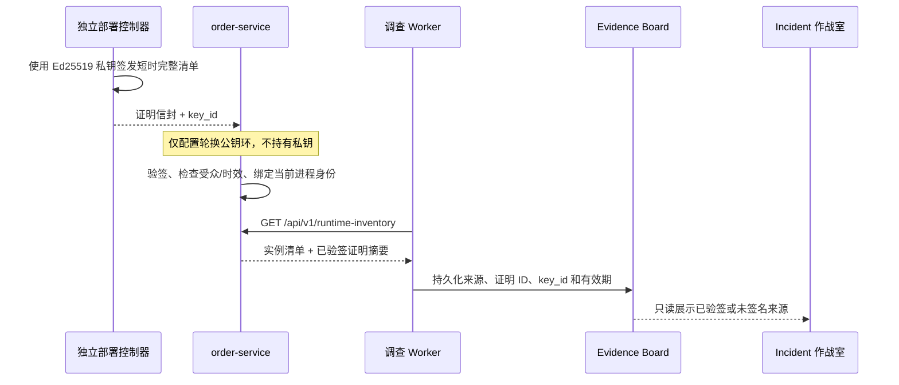

# Ed25519 签名运行清单证明

## 1. 目标与威胁边界

第 51 步的多实例清单来自订单服务启动环境。它能验证字段完整性和滚动发布规则，却不能回答“这份清单是否真由受信任的部署控制器产生”。本切片增加短时 Ed25519 签名证明，把签发权与服务读取权分离：

- 独立部署控制器持有私钥并签发完整清单；
- `order-service` 只持有一个最多 4 把公钥的轮换集合；
- 调查 Worker 只读取订单服务已经验签的结果；
- Agent、浏览器、白名单执行器和 Compose 都不接触私钥。

该证明认证的是“受信任控制器在某个时刻声明了这组实例和发布窗口”，不是实例存活、Ready、流量权重、镜像供应链签名或 Kubernetes API 的实时状态。

## 2. 信任链



即使 Agent 被提示注入诱导，它也只能读取 Evidence，不能签发新证明、替换公钥或修改实例集合。

## 3. 签名载荷与信封

签名载荷使用严格 Pydantic 模型，未知字段一律拒绝。载荷包含：

- `schema_version=1`；
- 唯一 `proof_id`；
- 固定受众 `opsswarm/order-service/runtime-inventory`；
- 固定服务名 `order-service`；
- `issued_at`、`expires_at`；
- 1～64 个完整实例身份；
- 稳定或进行中的滚动发布上下文。

信封额外包含 `key_id`、固定算法 `Ed25519` 和 64 字节签名的无填充 Base64URL 编码。签名前把载荷转换为 JSON 模式，按键排序，使用紧凑分隔符和 UTF-8 编码；签发方和验签方共享同一个规范化函数，避免空格或字段顺序造成歧义。

证明有效期最长 5 分钟，签发时间和过期时间必须带时区且严格递增。实例 ID 必须唯一，实例启动时间和滚动发布开始时间不能晚于签发时间。当前实现不允许未来签发时间的时钟宽限，部署控制器和工作负载应使用 UTC 同步时钟。

## 4. 密钥与配置

签名模式需要同时配置两个严格 JSON：

- `OPSSWARM_RUNTIME_INVENTORY_PROOF`：签名信封；
- `OPSSWARM_RUNTIME_PROOF_PUBLIC_KEYS`：`schema_version` 和 `keys` 映射。

公钥环至少 1 把、最多 4 把，`key_id` 只允许小写字母、数字、点、下划线和连字符。轮换时先把新公钥加入订单服务公钥环，再让控制器使用新的 `key_id` 签发，最后在旧证明全部过期后删除旧公钥。

`OPSSWARM_RUNTIME_INVENTORY_DECLARATION` 是兼容本地开发的未签名模式。它与签名证明严格互斥；证明或公钥只配置一半、运行身份关闭时注入证明、未知密钥、篡改签名、超长有效期或证明未绑定当前进程都会失败关闭。私钥没有对应的订单服务环境变量，也不会写入 `.env.example`。

## 5. 端点与失败语义

签名有效时，`GET /api/v1/runtime-inventory` 返回：

```json
{
  "schema_version": 1,
  "service_name": "order-service",
  "identity_source": "deployment-controller-ed25519",
  "instances": [
    {
      "instance_id": "aaaaaaaa-aaaa-4aaa-8aaa-aaaaaaaaaaaa",
      "image_repository": "ghcr.io/kill-t/ops-swarm-order-service",
      "image_digest": "sha256:bbbbbbbbbbbbbbbbbbbbbbbbbbbbbbbbbbbbbbbbbbbbbbbbbbbbbbbbbbbbbbbb",
      "started_at": "2026-09-01T07:59:30Z"
    }
  ],
  "rollout": {
    "phase": "stable",
    "rollout_id": null,
    "started_at": null,
    "deadline_at": null,
    "target_image_repository": null,
    "target_image_digest": null
  },
  "proof": {
    "proof_id": "dddddddd-dddd-4ddd-8ddd-dddddddddddd",
    "key_id": "controller-2026-09",
    "algorithm": "Ed25519",
    "issued_at": "2026-09-01T08:00:00Z",
    "expires_at": "2026-09-01T08:02:00Z"
  },
  "reported_at": "2026-09-01T08:01:00Z"
}
```

服务启动时完成首次验签和当前进程绑定；每次查询重新验签并检查当前时间。证明到期后端点返回专用 `503 runtime_inventory_proof_expired`，不会回退到未签名清单。调查适配器只有在收到精确的 `runtime_inventory_unavailable` 时才把功能视为关闭，因此证明过期、代理伪造的 `503` 或损坏响应都会让现场调查失败重试，而不是产生“无异常”的假证据。

未签名模式保持原响应字段和 `identity_source=deployment-environment`，不额外返回空的 `proof` 字段，避免破坏已有调用者。

## 6. Evidence 与页面复核

新调查会为当前部署 Evidence 保存：

- `runtime_proof_status`：`verified` 或 `unsigned`；
- `runtime_identity_source`；
- 已验签时的证明 ID、密钥编号、算法、签发和过期时间。

Evidence 不保存私钥、公钥或原始签名。浏览器不执行密码学验签，也不冒充独立验证方；它会重新校验来源与字段组合、UUID、密钥编号、算法、时区关系和 5 分钟上限，并把结果明确展示为“Ed25519 已验签”“未签名环境声明”“历史未签名声明”或“签名证明异常”。真正的密码学验证只发生在持有受信公钥的订单服务后端。

## 7. 数据库与兼容性

本切片不增加数据库表或迁移。证明摘要随调查 Evidence JSONB 固化，历史 Evidence 不回写。第 50 步的单实例字段、第 51 步未携带 `runtime_proof_status` 的多实例 Evidence 和当前未签名模式均继续可读；页面把旧多实例 Evidence 明确标为“历史未签名声明”。

新增 `cryptography` 仅用于 Ed25519 原语。项目没有自行实现椭圆曲线运算，也没有把私钥解析逻辑放进订单服务运行路径。

## 8. 当前限制与下一步

- 当前签名证明仍通过启动环境注入，证明过期后需要控制器生成新证明并重启或重新部署订单服务；还没有动态刷新通道。
- 仓库只提供纯签发函数来表达独立控制器边界，尚未创建长期持有私钥的控制器服务。
- Worker 信任固定本地/Compose 地址上的订单服务验签结果，没有再次携带公钥独立验签。
- 证明不包含 Kubernetes namespace、workload UID、Pod Ready、节点、可用区、重启次数或流量比例。
- 下一步应实现独立的本地部署控制器模拟器和受限证明刷新协议，再评估 Kubernetes 固定 namespace/workload 的只读适配器。

## 9. 面试表达

> 我把“字段合法”和“来源可信”分开处理。部署控制器用 Ed25519 私钥签完整实例清单和发布窗口，订单服务只拿最多四把轮换公钥，Agent 只消费验签后的 Evidence。证明固定受众、最长五分钟，并绑定当前进程的 UUID、镜像仓库和 digest；篡改、未知 key、过期或绑定不一致都会失败关闭，绝不降级成未签名声明。页面不会假装做密码学验证，只复核服务端验签摘要并明确展示信任等级。当前实现还是启动时证明，下一步才做独立控制器和动态刷新。
