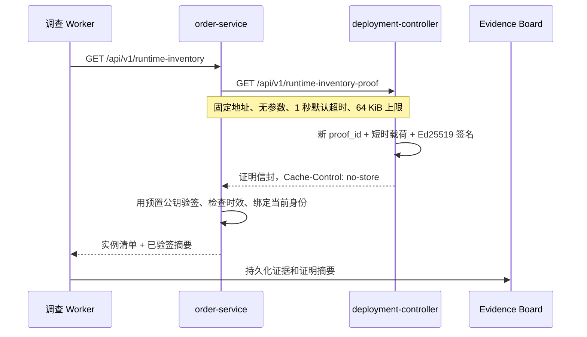

# 独立本地部署控制器与动态证明刷新

## 1. 目标

第 52 步的 Ed25519 证明已经能验证运行清单来源，但静态证明通过环境变量注入，过期后必须重启订单服务。本切片把签发权放入独立本地进程，并让 `order-service` 每次读取运行清单时获取新证明。

核心不是“多一个服务”，而是建立可检查的签发与验证边界：

- 部署控制器持有 Ed25519 私钥，但没有故障控制、Shell、Docker Socket 或数据库权限；
- 订单服务只持有预置公钥环，不接受签发方返回的新公钥；
- Worker 和 Agent 仍只读取订单服务已验签的摘要；
- 刷新失败不使用旧证明、未签名声明或进程内缓存兜底。

## 2. 组件与调用链

控制器端点是无参数的 `GET /api/v1/runtime-inventory-proof`。请求方不能指定实例、镜像、有效期、密钥编号或发布状态，因此不能利用该端点让控制器签任意内容。健康端点只返回服务名和健康状态。

## 3. 刷新边界

`OPSSWARM_RUNTIME_PROOF_REFRESH_BASE_URL` 不是通用 URL，只接受以下精确地址：

- `http://deployment-controller:8000`；
- `http://127.0.0.1:18003`；
- `http://localhost:18003`。

配置校验拒绝固定 HTTP 地址以外的协议、任意主机、其他端口、用户信息、路径、查询参数和 fragment，请求路径由代码固定。本地演练网络不启用 TLS，真实环境必须由平台内部 TLS 和工作负载身份取代这一地址白名单。

刷新请求不使用主机代理环境，超时必须大于 0 且不超过 3 秒。响应以流式方式读取，超过 64 KiB 立即中止。网络失败、非 `200`、超限、非法 JSON 统一返回 `503 runtime_inventory_proof_refresh_failed`；未知密钥、签名篡改、未生效、过期和身份不匹配保留精确的验签错误码。

## 4. 配置模式

运行清单共有三种互斥模式：

| 模式 | 订单服务配置 | 信任等级 | 用途 |
| --- | --- | --- | --- |
| 关闭 | 不启用运行身份 | 无 | 默认开发与兼容 |
| 未签名 | 身份 + 可选清单声明 | 环境声明 | 本地演练 |
| 静态签名 | 身份 + 证明信封 + 公钥环 | Ed25519 已验签 | 固定测试与向后兼容 |
| 动态签名 | 身份 + 固定控制器地址 + 公钥环 | Ed25519 已验签 | 连续本地演练 |

静态证明、动态刷新和未签名声明不能同时存在。动态模式中的公钥环仍由订单服务部署配置预置，不从控制器响应自动更新。

## 5. Compose 使用与密钥

`deployment-controller` 位于显式 `signed-runtime` profile，默认 `docker compose up` 不启动它，不改变普通故障演练。它只连接 `lab` 网络，主机端口绑定 `127.0.0.1:18003`，使用只读根文件系统、临时目录、删除 Linux capabilities 和 `no-new-privileges`。

启用时需要在不提交的 `.env` 中配置：

- 订单服务当前实例 UUID、无 tag 镜像仓库和 SHA-256 digest；
- 控制器 Ed25519 原始私钥的无填充 Base64URL 编码与 `key_id`；
- 订单服务预置的对应公钥环；
- `OPSSWARM_RUNTIME_PROOF_REFRESH_BASE_URL=http://deployment-controller:8000`。

本地 Compose 私钥会出现在控制器的进程环境与 Docker 容器元数据中，只适用故障演练，不是生产密钥方案。生产方案应使用 KMS/HSM 或 Secret 挂载、工作负载身份、审计和自动轮换。无论哪种模式，订单服务、Worker 和 Agent 都不持有私钥。

## 6. 时效、轮换与恢复

控制器默认签发 120 秒证明，可配置范围为 30～300 秒，每次请求使用新 UUID。订单服务不缓存证明，因此控制器恢复后的下一次查询即可自动恢复，无需重启订单服务。

密钥轮换仍遵守“先信任、再签发、后移除”：先把新公钥加入最多 4 把的订单服务公钥环，再切换控制器私钥和 `key_id`，最后等待旧证明最大有效期结束后移除旧公钥。

## 7. 持久化与兼容性

本切片不增加数据库表或迁移。证明摘要仍由调查 Worker 写入 Evidence JSONB，原始证明、公钥和私钥都不入业务库。静态签名与未签名模式保留，旧 Evidence 无需迁移。

## 8. 当前限制

- 本地控制器从启动配置读取声明，没有连接 Kubernetes 或其他真实服务发现。
- 当前实例的 `started_at` 是本地控制器启动时间，用于稳定演练契约，不代表真实 Pod 启动时间。
- 该端点可用性会影响现场变更调查；这是刻意的失败关闭，但生产系统还需要高可用控制器、限流和可观测性。
- 签名只证明控制器声明的完整性和来源，不证明实例 Ready、流量权重或镜像供应链安全。
- 下一步应先为控制器增加 Prometheus 指标与结构化审计事件，再评估固定 namespace/workload 的 Kubernetes 只读适配器。

## 9. 面试表达

> 我把短时证明的签发和验证拆成两个进程。控制器只提供无参数读接口并持有 Ed25519 私钥，订单服务只持有预置公钥环。刷新 URL、路径、超时和 64 KiB 响应都是确定性白名单，每次读取都刷新、验签并绑定当前身份。任何刷新或验签错误都返回 503，不回退旧证明。Compose 私钥只是本地演练方案，生产中会换成 KMS/HSM 和工作负载身份。
