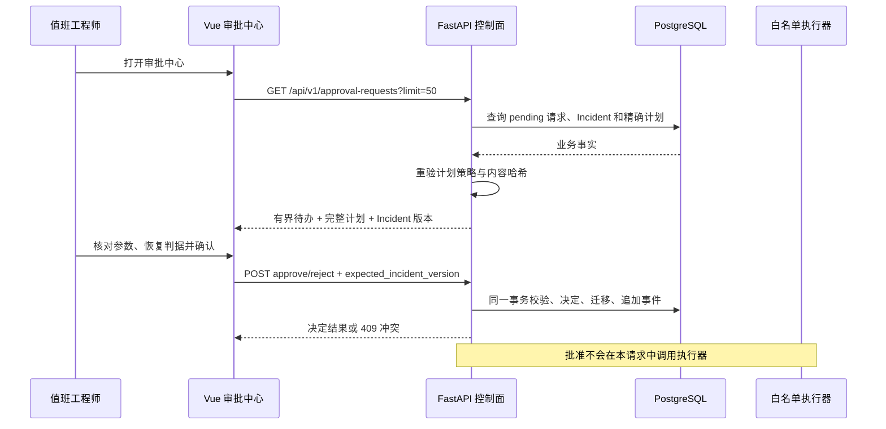

# 本地审批中心与待办队列

## 1. 目标

前面的审批能力已经具备精确版本绑定、内容哈希校验、过期收敛和不可变决定，但调用方必须预先知道审批请求 ID。值班工程师缺少一个可以发现待办、复核完整计划并提交人工决定的入口。

本切片增加一个有界只读队列和 Vue 审批中心。它只解决“看见并决定”，不把审批和执行合并，也不扩大 LLM、浏览器或 Agent 的权限。

## 2. 安全边界

- 队列只返回数据库中状态为 `pending` 的请求，并要求其 Incident 和计划都处于 `awaiting_approval`。
- 每条待办携带精确计划版本、计划内容 SHA-256、Incident 当前乐观锁版本和完整白名单步骤。
- 计划从数据库读取时重新执行原有 Pydantic 形状、风险策略和内容哈希校验，队列不会成为绕过完整性检查的旁路。
- 页面提交的只有决定、Incident 预期版本、操作者声明和原因；不能提交动作类型、目标、参数、命令或 URL。
- 批准只把请求、计划和 Incident 推进到批准后的业务状态，不调用白名单执行器，也不修改故障环境。
- 当前没有身份认证，`actor_id` 只是本地审计声明。页面显著标记 `LOCAL FAULT LAB`，不能视为生产授权界面。

## 3. 待审批队列契约

新增 `GET /api/v1/approval-requests?limit=50`：

- `limit` 默认 50，范围固定为 1～100，避免无界读取完整计划；
- 以 `expires_at`、`created_at`、请求 ID 升序排列，最早到期优先；
- `total` 表示数据库中的全部待办数，`items` 只包含本次上限内的待办；
- 每项包含 `approval_request`、Incident 最小快照和完整 `action_plan`；
- 当前不自动把过期记录改成 `expired`，因为 GET 保持只读；工程师提交决定时由原有决定事务原子收敛过期状态。

队列没有新增数据库表或迁移。它是现有审批、计划、调查和 Incident 表上的读取投影，不复制第二份审批事实。

## 4. 页面交互

路由为 `/approvals/:requestId?`。左侧按最早到期展示待办，右侧展示：

- Incident 严重级别、服务和作战室入口；
- 计划版本、Incident 乐观锁版本、风险策略和内容哈希；
- 每个白名单步骤的确定性动作、精确参数、风险说明和恢复判据；
- 请求人、请求原因、有效期以及人工决定表单。

操作者必须填写决定原因并勾选已经核对计划、参数、风险和恢复判据，按钮才会启用。批准成功后页面明确提示“尚未执行任何环境操作”，并重新读取队列。

如果其他工程师已经处理请求、Incident 版本改变、计划内容漂移或请求到期，后端返回 `409`。页面保留错误并刷新队列，不用旧页面数据覆盖最新状态。URL 中的请求已不存在时，页面选择剩余最早到期项；队列为空时回到无选择状态。

## 5. 当前限制

- 没有登录、RBAC、双人复核、审批策略或生产身份，因此只能绑定 localhost/Compose 私网。
- 当前一次最多展示 50 条完整计划；规模增大后应增加游标分页和计划摘要/详情分离，但不能牺牲决定前的完整复核。
- 浏览器仍不能触发白名单执行、恢复验证、关闭 Incident 或任意环境命令。
- 页面用客户端时间提示是否过期，服务器时间和决定事务才是最终事实。

## 6. 面试表达

> 我先把审批做成了数据库中的精确版本事务，再补 UI，而不是让按钮直接调用环境。审批中心通过有界队列返回 Incident 乐观锁、计划版本、内容哈希、精确白名单参数和恢复判据。工程师提交决定时后端再次校验状态和完整性，冲突返回 409 并刷新。批准只授予后续执行资格，不执行动作，这样 Human-in-the-loop 和确定性执行器是两个清晰的安全边界。
