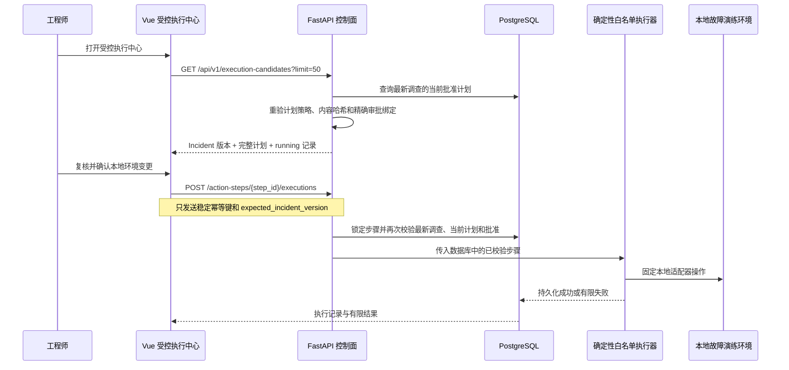

# 已批准计划的受控执行中心

## 1. 目标

第 54 步允许工程师在浏览器中复核并批准计划，但批准后的请求会离开待审批队列。虽然控制面已经存在白名单执行 API，调用方仍必须预先知道动作步骤 ID、Incident 当前版本和幂等键，页面没有安全、可发现的执行入口。

本切片增加“已批准、待执行”只读投影和独立受控执行页面。它把人工授权和环境变更保持为两个明确动作：批准不会执行，工程师必须再次复核后逐个触发数据库中已经批准的步骤。

## 2. 执行授权链



真正的授权条件全部在后端重新检查：

- Incident 必须处于 `mitigating` 且版本与页面读取时一致；
- 计划必须属于该 Incident 最新一次调查；
- 计划必须是该调查的最高版本并处于 `approved`；
- 审批必须精确绑定该计划 ID、版本和内容哈希，并处于 `approved`；
- 步骤动作类型必须存在对应的确定性本地执行器。

增加“最新调查”限制是必要的：旧事故周期中曾批准过的步骤即使 ID 泄露，也不能在后续调查进入 `mitigating` 时重新获得执行资格。

## 3. 待执行投影

新增 `GET /api/v1/execution-candidates?limit=50`：

- `limit` 默认 50，范围固定为 1～100；
- 只选择 Incident 最新调查中的最高版本计划；
- Incident、计划和审批状态必须分别为 `mitigating`、`approved`、`approved`；
- 每项包含精确审批请求、Incident 当前快照、完整结构化计划和该计划的 `running` 执行记录；
- 成功操作会把 Incident 迁移到 `verifying`，失败操作会返回 `investigating`，因此两种终态都会自然离开候选队列；
- GET 保持只读，不领取租约、不调用执行器，也不修复业务状态。

投影不增加数据库表或迁移。PostgreSQL 中的 Incident、调查、计划、审批和执行记录仍是唯一业务事实。

## 4. 浏览器幂等与交互

页面路由为 `/executions/:planId?`。工程师可以查看批准人、批准原因、内容哈希、Incident 乐观锁、每个白名单动作的精确参数、风险说明和恢复判据。

浏览器不能编辑动作类型、目标、参数、命令或 URL。执行请求只有：

```json
{
  "idempotency_key": "ui-exec:{approval_request_id}:{step_id}",
  "expected_incident_version": 4
}
```

幂等键由审批请求 ID 和步骤 ID 稳定派生。同一个页面重试、网络响应丢失或浏览器刷新后仍指向同一个业务操作，不会因为随机生成新键而重复修改环境。真实 UUID 组合后的键长度在服务端 8～100 字符限制内。

页面必须勾选“只操作本地故障演练环境并已复核授权、参数、幂等键和恢复判据”，执行按钮才会启用。页面发现已有 `running` 记录时展示其真实幂等键、执行器、尝试次数和租约，并阻止创建不同键的并发操作。

成功后页面展示持久执行状态、执行器、尝试次数、幂等键和有限结构化结果，同时提示 Incident 已进入恢复验证。409 或 502 会保留错误并重新读取候选，不用旧版本强制重试。

## 5. 安全边界与限制

- 当前页面会真实修改项目自己的 Docker Compose 故障演练环境，只能绑定 localhost/Compose 私网。
- 页面没有认证或 RBAC；生产中必须增加工作负载身份、工程师身份、授权策略和更严格的审计。
- LLM、Agent 和浏览器都不能提供 Shell、SQL、通用 HTTP URL 或任意动作参数。
- 当前确定性规划器生成单步骤计划；模型允许多步骤是为后续编排预留。现有成功迁移会进入 `verifying`，因此不要把页面解释为通用批量变更编排器。
- `running` 记录当前依靠手动刷新读取；后续可以增加有界轮询或事件推送，但不能绕过数据库租约事实。
- 本切片不从浏览器创建恢复验证运行；下一步单独增加验证中心，继续保持“执行成功”和“系统已经恢复”两个状态。

## 6. 面试表达

> 我把人工批准和环境执行拆成两个页面、两个事务。执行中心只查询最新调查中的当前批准计划，浏览器只能提交步骤 ID、稳定幂等键和 Incident 乐观锁，参数始终来自数据库。后端在领取租约前再次验证最新调查、计划版本、内容哈希和审批绑定，再调用固定本地适配器。成功只是进入 verifying，并不等于事故恢复，这样授权、执行和验证三层边界都很清楚。
