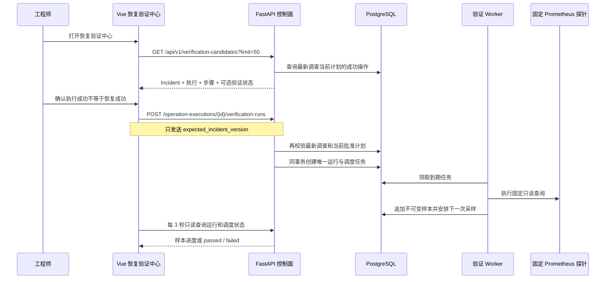

# 恢复验证中心与采样进度展示

## 1. 目标

受控执行成功后，Incident 只进入 `verifying`，这表示白名单动作已经完成，不表示被管系统已经恢复。此前工程师必须知道执行记录 ID，手动调用验证 API，且无法从浏览器观察常驻 Worker 的采样进度。

本切片增加“待验证”只读投影和独立恢复验证页面。工程师可以发现当前事故周期中的成功操作，显式创建唯一验证运行，并观察服务端固定探针产生的样本和最终判定。

## 2. 验证链路

页面不会调用手动样本接口。正常采样始终由常驻 Worker 根据 PostgreSQL 中的 `available_at`、租约和稳定幂等键推进，刷新浏览器不会改变调度状态。

## 3. 待验证投影与旧执行隔离

新增 `GET /api/v1/verification-candidates?limit=50`：

- `limit` 默认 50，只允许 1～100；
- Incident 必须为 `verifying`；
- 操作必须为 `succeeded`；
- 操作必须属于 Incident 最新调查中的最高版本 `approved` 计划；
- 每项返回 Incident 当前版本、有限执行结果、精确动作步骤、可选验证运行和不含租约令牌的调度任务；
- 验证通过或失败会让 Incident 离开 `verifying`，候选因此自然消失；
- GET 不创建运行、不领取任务、不执行探针，也不修复不一致数据。

验证创建接口也独立执行同样的“最新调查 + 当前批准计划”检查。只在候选查询中过滤不够安全，因为调用方仍可能持有旧执行 ID 并直接请求创建验证。双重校验可以阻止旧调查周期的成功操作在新周期中错误地把 Incident 迁移到 `resolved`。

本切片没有增加数据库表或迁移；候选是 `incidents`、`investigation_runs`、`action_plans`、`action_steps`、`operation_executions`、`verification_runs` 和 `verification_work_items` 的有界只读投影。

## 4. 页面状态与恢复

页面路由为 `/verifications/:executionId?`，展示：

- Incident、成功执行器、完成时间和有限结果关联；
- 数据库动作的固定目标和参数；
- 已冻结的信号、比较符、阈值、成功样本数和观察窗口；
- 验证运行状态、成功样本进度、首次成功与最近观测时间；
- 调度任务状态、下一样本序号、到期时间、Worker、尝试次数和有限错误；
- 按序展示的不可变样本及最终 `passed` 或 `failed` 结论。

页面每 3 秒轮询运行与调度只读接口，仅在当前观察运行仍为 `running` 时发起请求，终态后停止。候选离开队列时，Pinia 仍保留本次读取到的终态结果，让工程师看清为什么进入 `resolved` 或返回 `investigating`，而不是因列表更新突然丢失反馈。

## 5. 安全边界

- 浏览器不能提交信号、阈值、目标、URL、PromQL、观测值、HTTP 状态或采样时间。
- LLM 和 Agent 不参与验证判定；规则来自数据库中的已批准步骤。
- 页面不能领取或延长 Worker 租约，也不能看到 `lease_token`。
- 人工确认只表达启动意图，不能覆盖乐观锁或服务端授权检查。
- 页面仍只适用于 localhost 和项目 Docker Compose 演练环境，没有认证、RBAC 或生产授权能力。

## 6. 当前限制与下一步

- 当前使用 3 秒短轮询；事故事件已有可重放 SSE，但验证样本还没有独立事件类型。
- 页面重新打开后只能发现仍处于 `verifying` 的运行，历史终态应从 Incident 作战室查看。
- 验证失败后仍需工程师从作战室重新开始调查，没有一键创建下一调查周期。
- 下一切片补充 `resolved` Incident 的人工关闭入口，把浏览器主流程推进到明确终态；关闭仍必须使用乐观锁并与恢复判定分离。

## 7. 面试表达

> 我把“动作执行成功”和“系统恢复成功”做成两个独立业务状态。恢复验证中心只列出最新调查当前计划的成功操作，浏览器只能提交 Incident 版本来创建验证，不能篡改阈值或观测值。常驻 Worker 按 PostgreSQL 调度和固定 Prometheus 探针自动采样，页面只读轮询进度。验证创建接口还会再次拒绝旧调查的成功执行，避免旧操作错误关闭新事故周期。
