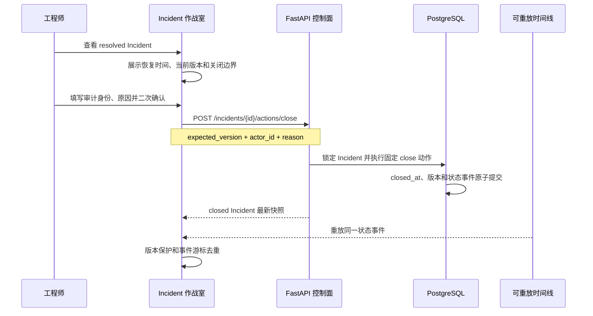

# 已恢复 Incident 的人工关闭入口

## 1. 目标

恢复验证通过只说明系统健康，Incident 会进入 `resolved`，仍需工程师明确确认本次事故生命周期结束。第 57 步在 Incident 作战室增加关闭入口，让浏览器主流程从告警、调查、审批、执行、验证继续走到 `closed`。

后端状态机、事务和 API 已在 [Incident 关闭与告警复发](19-incident-closure-and-recurrence.md) 中完成。本切片不增加数据库表或状态动作，只补前端命令边界、冲突恢复和可验证交互。

## 2. 关闭流程

关闭成功后，REST 响应立即更新列表和详情；随后到达的 SSE 事件仍按既有游标去重和版本保护处理。页面不会因为 REST 与 SSE 到达顺序不同而把 Incident 倒退。

## 3. 页面命令边界

关闭面板只在 `resolved` 或 `closed` 显示：

- `resolved` 展示恢复确认时间、Incident 当前版本、审计操作者、关闭原因和二次确认；
- 请求由 Pinia 使用当前选中 Incident 的版本构造，组件不能指定版本或目标状态；
- 浏览器只发送 `expected_version`、`actor_id` 和 `reason`，没有 `target_status`、`force` 或自动执行字段；
- `closed` 只展示终态时间和复发语义，不再渲染表单或按钮；
- 其他状态完全不显示关闭入口，后端仍会独立拒绝绕过页面的非法调用。

当前 `actor_id` 只是本地审计声明。页面明确说明没有登录认证，不能把输入框内容当成可信身份。

## 4. 乐观锁冲突与复发

工程师查看 `resolved` 后，新的同指纹告警可能先到达并把 Incident 迁回 `investigating`。此时旧页面提交的版本会收到 `409 incident_version_conflict`，前端不会自动重试关闭，而是：

1. 保留服务端返回的关闭错误；
2. 重新读取该 Incident 最新快照；
3. 让更高版本的 `investigating` 状态替换旧 `resolved`；
4. 隐藏关闭入口，要求重新调查和验证。

这条失败路径比“自动刷新版本后重试”更重要，因为版本变化可能表示故障真实复发。页面不能把并发冲突当成纯技术错误并覆盖新的业务事实。

## 5. 安全与当前限制

- 关闭不会调用故障环境、执行器、Agent 或模型，只提交生命周期状态和审计事件。
- 关闭原因是有长度限制的文本，不支持附件或结构化复盘分类。
- 当前没有认证、RBAC 或强身份，只能用于 localhost 和项目 Docker Compose 演练环境。
- 没有自动关闭策略；保留人工动作是明确的人机边界。
- 事故报告尚未形成独立持久快照和导出文件，下一步可以基于已关闭 Incident 的不可变事实生成复盘报告。

## 6. 面试表达

> 我把 resolved 和 closed 分开：固定探针证明恢复后，只允许工程师在作战室明确关闭。前端不传目标状态，而是用当前 Incident 版本加审计身份和原因调用固定 close API。若关闭前告警复发，乐观锁冲突后页面只读取最新状态，绝不自动升级版本重试，因此不会把已经回到 investigating 的事故错误关闭。REST 与 SSE 更新都受版本和事件游标保护。
