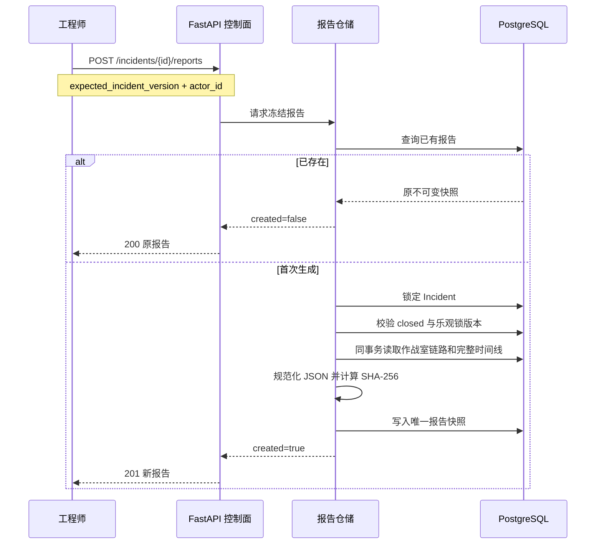

# 确定性事故复盘报告快照

## 1. 目标

事故进入 `closed` 后，把分散在 Incident、时间线和处置链路中的最终业务事实冻结成一份可重复读取、可校验的结构化报告。报告用于值班交接、复盘展示和后续导出，不依赖查询时的代码版本，也不让模型补写数据库中不存在的结论。

本切片只完成 PostgreSQL 快照和 REST 接口。Markdown/PDF 导出、报告列表和前端展示留给后续切片。

## 2. 生成边界

只有 `closed` Incident 可以首次生成。`resolved` 仍可能因告警复发回到调查，因此不能提前冻结“最终”复盘。首次生成要求当前 Incident 版本，避免操作者基于过期页面确认；已经生成后，重复请求无论携带何版本都只返回原报告，符合幂等重试语义。

## 3. 报告结构

`incident-report.v1` 内容包含四组事实：

- 生成信息：结构版本、生成时间和本地审计操作者；
- Incident 快照：展示编号、服务、标题、级别、指纹、最终版本、发生/恢复/关闭时间和确定性恢复耗时；
- 作战室快照：最近调查、Evidence Board 主假设、当前计划、审批、最近执行和恢复验证摘要；
- 完整时间线：最多 500 条已有 `incident_events`，保留全局游标、操作者、状态、原因和有限 payload。

报告不复制原始日志、模型提示词、密钥或无限制工具输出。Evidence Board 只进入已有作战室摘要：根因陈述、置信度、质疑结论以及证据/专业报告数量。需要深挖时仍通过原领域明细接口读取源事实。

首版对超过 500 条的时间线明确返回冲突，不静默截断。后续若真实规模需要更大报告，应通过分区附件或对象存储契约演进，而不是悄悄改变 v1 含义。

## 4. 持久化与完整性

`incident_reports` 以 UUID 为主键，`incident_id` 唯一并使用 `ON DELETE RESTRICT`。记录同时保存：

- `incident_version`：说明快照绑定的关闭版本；
- `schema_version`：当前固定为 `incident-report.v1`；
- `content`：严格 Pydantic 校验后的 JSONB；
- `content_hash`：对键排序、无多余空白的 UTF-8 JSON 计算 SHA-256；
- `created_at`：报告冻结时间。

读取时重新把 JSONB 解析为 v1 模型并计算摘要。结构不合法、schema 版本漂移或哈希不一致都返回完整性错误，而不是把被修改的数据当成合法复盘。应用没有更新和删除报告的方法。

## 5. 一致性与并发

作战室查询抽出 `load_workroom_snapshot_in_session`，让页面仓储和报告仓储共享同一选择规则。首次生成在一个数据库事务中完成：

1. 快速检查唯一报告；
2. `FOR UPDATE` 锁定 Incident；
3. 锁后再次检查报告，覆盖两个并发请求都在锁前读到空值的竞争；
4. 校验状态和版本；
5. 在同一会话读取作战室链路与时间线；
6. 写入快照并提交。

`closed` 是 Incident 终态，新同指纹告警会创建新 Incident，因此报告绑定的事故不会再次迁移。数据库唯一约束仍作为最后防线。

## 6. 安全与限制

- 报告生成不调用 LLM、Agent、Shell、外部平台或故障环境。
- `actor_id` 仍只是 localhost 演练环境中的审计声明，不是可信身份。
- 哈希用于发现库内内容漂移，不是电子签名，也不能证明外部证据来源真实性。
- 当前只保留结构化 JSONB；尚未提供人类友好的 Markdown/PDF 文件和前端入口。
- 当前报告没有结构化后续改进项、负责人和截止时间，这需要独立行动项模型，不能由模型凭空补齐。

## 7. 面试表达

> 我把事故报告设计成关闭后的不可变业务快照，而不是每次打开页面动态拼接。服务端在一个事务中锁定 closed Incident，复用作战室的同会话查询规则，收集完整时间线，规范化 JSON 后保存 SHA-256。重复请求返回原报告，并发请求在锁后复查；读取时重新验模型和哈希。LLM 不参与补写事实，因此报告可复现，也不会把幻觉变成审计记录。
