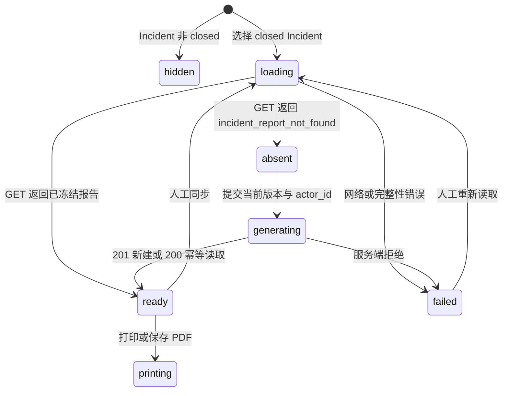

# 事故复盘报告生成、查看与打印

## 1. 目标

第 58 步已经把已关闭事故冻结为不可变 JSONB 快照。本切片把该能力接入 Incident 作战室，让工程师可以：

- 识别一个关闭事故是否已有报告；
- 只提交当前版本和审计操作者来生成报告；
- 阅读根因、证据规模、处置、审批、执行、验证和完整时间线；
- 使用浏览器打印能力保存 PDF。

页面不提供任何报告正文编辑框，也不在前端重新推导根因或恢复结论。

## 2. 页面状态流



`incident_report_not_found` 是正常业务空状态，因此 Pinia 将其转换为 `report=null`，不显示红色错误；其他 `404`、`409`、`500` 或网络失败都保留为显式错误。读取失败时会清除旧报告，避免完整性检查失败后仍展示缓存内容。

## 3. 命令与状态边界

报告生成表单只有一个可填写字段 `actor_id`。Pinia 从当前选中的 `closed` Incident 取得 `expected_incident_version`，组合成请求：

```json
{
  "expected_incident_version": 7,
  "actor_id": "engineer-001"
}
```

组件不能提交 `content`、根因、时间线、处置、验证、哈希或结构版本。服务端返回后，store 还会检查 `report.incident_id` 是否仍对应当前选择；切换事故会递增请求代次，迟到响应不能覆盖新选择。

报告加载状态与作战室聚合状态分开管理。选择关闭事故时两者并行读取，因此报告接口失败不会清空 Incident 或处置链路，作战室失败也不会伪造报告失败。

## 4. 只读报告版式

报告采用独立浅色文档区域，与深色作战室控制界面区分，包含：

1. Incident 编号、标题、服务、级别和关闭版本；
2. 发生、恢复、关闭时间及服务端冻结的恢复耗时；
3. 主根因陈述、分类、置信度、证据和专业报告数量；
4. 处置计划、风险、步骤和审批结果；
5. 执行器、执行状态、验证状态和样本统计；
6. 按持久游标排序的完整时间线；
7. 生成操作者、结构版本和完整内容哈希。

可选业务阶段缺失时，页面明确写“没有记录”或“不由页面补写”，不会用空字符串伪装成已知事实。

## 5. 打印与安全

“打印 / 保存 PDF”调用浏览器原生 `window.print()`，不引入 PDF 生成依赖，也不把报告上传到第三方服务。打印媒体样式隐藏导航、Incident 列表、关闭控件和其他作战室内容，只保留报告本体，并使用白色背景与避免段内分页的规则。

当前限制：

- 浏览器保存的 PDF 是用户侧派生文件，数据库中的 JSONB 才是业务事实来源；
- 当前没有身份认证，`actor_id` 仍只是本地审计声明；
- 页面展示摘要，不展开原始证据 attributes 或执行结果 JSON；
- 没有结构化改进项、负责人和截止日期；这些需要独立领域模型。

## 6. 面试表达

> 我把复盘 UI 设计为后端不可变快照的只读投影。选择 closed Incident 时，前端并行读取作战室和当前报告；报告不存在是正常空状态，完整性错误则失败关闭。生成组件只能提交当前乐观锁版本和审计操作者，不能改写正文。返回结果还要匹配当前 Incident，并通过请求代次防止切换页面后的迟到覆盖。打印使用浏览器原生能力和专用 print CSS，不引入新的可信边界。
