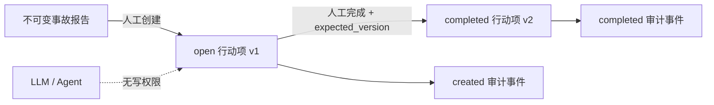

# 复盘改进行动项与完成审计

## 1. 目标

事故报告冻结后，工程师仍需要把“以后怎么避免再次发生”转成有负责人、有截止时间、有完成事实的工作。本切片在不可变 `incident_reports` 之外建立独立行动项模型，让报告继续保持原始复盘快照不变，同时让改进工作能够推进和审计。

本步只实现 PostgreSQL 领域模型和 REST 接口，不实现前端、通知、逾期升级、编辑、重开或第三方工单同步。

## 2. 领域边界

- 行动项必须归属于已经存在的冻结报告，不能直接挂在仍会变化的 Incident 上。
- 报告内容不因行动项创建或完成而更新，报告 SHA-256 仍代表事故关闭时的原始事实。
- `open` 是版本 1，`completed` 是版本 2；首版没有编辑和重开，因此生命周期刻意保持最小。
- LLM 可以在未来输出“建议行动项”，但不能调用创建或完成接口。组织责任必须由人工明确提交。

## 3. 幂等与并发

创建请求携带调用方生成的 `idempotency_key`。数据库对 `(report_id, idempotency_key)` 建立唯一约束，仓储先锁定报告，再判断同键内容：

- 标题、描述、负责人、截止时间和创建人完全相同：返回原行动项，`created=false`；
- 同键内容不同：返回冲突，禁止把重试伪装成编辑；
- 不同报告可以使用相同幂等键。

完成请求携带 `expected_version`。仓储使用 `SELECT ... FOR UPDATE` 锁定行动项，只有 `open` 且版本匹配时才能迁移。首次完成把版本增至 2，并在同一事务追加事件。已完成后，完成者和说明完全相同的重试返回 `completion_applied=false`；不同内容的重试拒绝改写审计。

## 4. 持久化模型

`report_action_items` 保存当前投影：

- 业务内容：标题、描述、负责人和 UTC 截止时间；
- 生命周期：`open` / `completed`、乐观锁版本；
- 创建审计：创建人和创建时间；
- 完成审计：完成者、完成说明和完成时间，三个字段必须同时为空或同时存在。

`report_action_item_events` 只追加创建和完成事实。全局递增 `id` 可作为稳定审计游标，`(action_item_id, item_version)` 唯一，保证同一版本最多一条事件。两张表都通过 `ON DELETE RESTRICT` 保护审计链，不提供物理删除接口。

## 5. HTTP 契约

| 方法与路径 | 语义 |
| --- | --- |
| `POST /api/v1/incident-reports/{report_id}/action-items` | 首次创建 `201`，同命令重试 `200` |
| `GET /api/v1/incident-reports/{report_id}/action-items` | 待完成优先、截止时间升序的有界列表 |
| `POST /api/v1/report-action-items/{item_id}/actions/complete` | 使用版本完成；相同完成命令可安全重试 |
| `GET /api/v1/report-action-items/{item_id}/events` | 返回创建到完成的追加式审计时间线 |

接口中的 `actor_id` 和 `owner_id` 仍是 localhost 演练环境的审计标识，不是已认证身份。后续接入身份系统时，应由服务端从认证上下文取得操作者，不能继续信任任意请求字段。

## 6. 限制与后续演进

- 首版不允许修改标题、负责人、截止时间或完成说明，也不允许重开。
- 尚未定义逾期状态；是否逾期可以由 `open` 与服务器当前时间派生，不重复持久化易漂移布尔值。
- 尚未同步 GitHub Issues、Jira 等外部工单；接入时需要独立外部幂等标识和失败补偿。
- 第 61 步已在事故复盘页面增加行动项列表、人工创建和完成交互，后端仍保存唯一事实。详见[复盘改进行动项前端闭环](61-report-action-items-ui.md)。

## 7. 面试表达

> 我没有为了跟踪改进工作去修改已经冻结的事故报告，而是把报告当作不可变聚合根快照，在它下面建立独立的版本化行动项。创建用报告内幂等键，完成用行锁和乐观锁，当前状态与追加事件同事务提交；完全相同的网络重试安全返回，内容不同的重试失败关闭。这样既保住复盘报告的可复现性，也能表达事故之后真实发生的组织改进。
