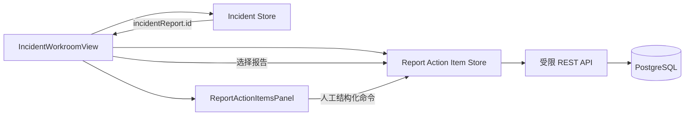

# 复盘改进行动项前端闭环

## 1. 目标

第 60 步已经建立报告行动项的持久状态、幂等创建、乐观锁完成和追加式审计。本切片把这些能力接入 Incident 作战室，让工程师在查看冻结报告后可以：

- 查看待完成和已完成行动项；
- 登记标题、说明、负责人和截止时间；
- 使用当前服务端版本提交完成说明；
- 在冲突后看到最新状态和原始错误。

页面不允许编辑冻结报告，也不把行动项创建或完成能力暴露给 Agent。

## 2. 前端边界



行动项使用独立 Pinia store，不继续扩张 Incident store。Incident store 负责事故、作战室和不可变报告；行动项 store 只负责当前报告下的可变跟踪状态。视图监听 `incidentReport.id`：报告出现时选择并加载行动项，报告消失或页面卸载时立即清空。

每次选择报告和加载列表都有递增请求代次。响应只有在报告 ID、选择代次和加载代次都仍匹配时才能落入页面，因此切换 Incident 后的迟到响应不会覆盖新报告。

## 3. 创建幂等键

表单为每份草稿生成符合后端约束的 `follow-up-{uuid}` 幂等键，但不把它作为普通业务字段展示给用户：

- 用户编辑任意创建字段时生成新键，表示一份新命令内容；
- 提交后如果网络失败且内容没有变化，再次提交继续使用原键；
- 服务端返回对应行动项后清空草稿并生成下一枚键；
- 同键内容冲突由后端 `409` 明确拒绝，页面不会自动换键掩盖冲突。

浏览器只负责稳定重试标识，最终去重仍由 PostgreSQL `(report_id, idempotency_key)` 唯一约束和仓储内容比较保证。

## 4. 乐观锁完成

完成表单只收集操作者和完成说明。组件上送行动项 ID，Pinia 从当前服务端快照读取 `version` 并构造：

```json
{
  "expected_version": 1,
  "actor_id": "engineer-002",
  "completion_note": "演练脚本和恢复检查已经合入"
}
```

页面不能输入、递增或猜测版本。发生 `report_action_item_version_conflict` 或 `report_action_item_already_completed` 时，store 重新读取当前报告的列表，但保留原始错误提示；它不会拿新版本自动重放完成命令，因为那会越过工程师对最新状态的确认。

## 5. 展示与时间语义

列表保持与服务端一致的顺序：`open` 在前，同状态按截止时间和 ID 排序。卡片展示负责人、截止时间、创建审计、版本和完成审计；`open` 且截止时间早于浏览器当前时间时显示“已逾期”，但数据库仍只保存 `status=open` 和 `due_at`，不持久化容易漂移的逾期布尔值。

`datetime-local` 表示用户所在时区的墙上时间，提交前由浏览器转换为 UTC ISO 8601。服务器仍负责最终校验截止时间是否晚于创建时间，浏览器时间不能成为可信业务时钟。

行动项面板位于浅色不可变报告文档之外。打印规则继续只显示 `.incident-report-panel`，因此浏览器保存的事故报告 PDF 不会混入生成后持续变化的行动项状态。

## 6. 安全与限制

- `actor_id` 和 `owner_id` 仍是本地演练审计声明，不是登录身份。
- 页面没有编辑、重开、删除、批量完成或通知能力。
- 页面不调用行动项事件接口；当前卡片展示当前投影中的创建和完成审计。
- 当前不连接 GitHub Issues、Jira 等外部工单系统。
- LLM 可以在未来生成待人工采纳的候选建议，但不能调用当前写接口。

## 7. 面试表达

> 我把复盘行动项做成独立前端状态域，不和不可变报告状态混在一起。创建草稿持有稳定幂等键，内容不变的网络重试不会重复建任务；完成版本只从服务端当前快照取得。版本冲突后页面刷新事实但不自动重试命令，要求工程师重新确认。报告切换用双代次隔离迟到响应，而且可变行动项不进入不可变报告的打印区域。
