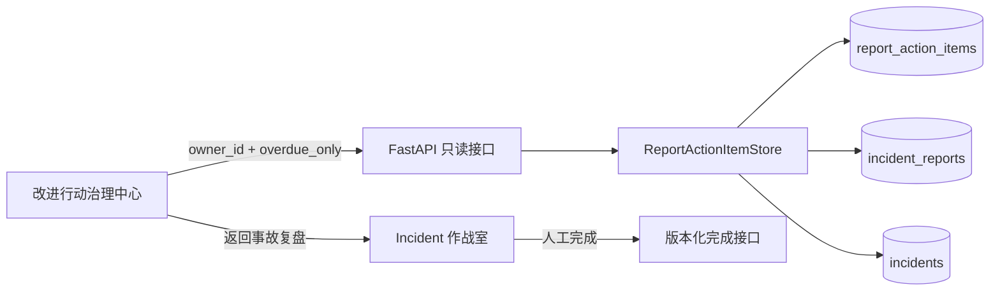

# 跨事故改进行动项治理中心

## 1. 目标

单个事故复盘页适合创建和完成行动项，但负责人和研发主管还需要一个跨事故入口，快速回答：目前有哪些改进工作未完成、哪些已经逾期、某位负责人名下有哪些任务。

本切片增加只读聚合 API 和独立治理页面。它只建立全局索引，不提供批量完成、重新分配或绕过事故上下文的写入口。

## 2. 只读聚合边界

`GET /api/v1/report-action-items` 固定只返回 `open` 行动项，并联结冻结报告与 Incident 的最小上下文。它不复用报告 JSONB 中的事故字段，避免把可查询关系隐藏在文档内容内。

响应包含：

- 当前行动项完整投影；
- Incident ID、展示编号、标题、服务和严重级别；
- 服务器判定的 `overdue`；
- 本次查询的 UTC `as_of`、负责人筛选和仅逾期开关。

页面使用 Incident ID 返回具体作战室，在原报告上下文中完成任务。治理中心本身没有写按钮。

## 3. 筛选与时间语义

当前接口只接受三个有界查询条件：

| 参数 | 语义 |
| --- | --- |
| `owner_id` | 可选，去除首尾空白后的负责人精确匹配 |
| `overdue_only` | 默认 `false`；为真时要求 `due_at < as_of` |
| `limit` | 默认 100，范围 1～200 |

逾期只由服务器 UTC 时钟判定，等于截止时间时尚不算逾期。响应回显 `as_of`，让页面能说明判定基准；浏览器只展示服务端 `overdue`，不拿本地时钟重算业务筛选。

结果按 `due_at ASC`、Incident 展示序号和行动项 ID 稳定排序。`total` 是当前筛选条件下的完整数量，返回集合有界；超过上限时页面提示继续用负责人或逾期条件缩小范围。

## 4. 查询驱动索引

原 `(report_id, status, due_at)` 索引服务于单份报告，无法高效支持跨报告待办。迁移 `0029_follow_up_governance_idx` 增加两个 PostgreSQL 部分索引：

- `ix_report_action_items_open_due (due_at) WHERE status = 'open'`；
- `ix_report_action_items_open_owner_due (owner_id, due_at) WHERE status = 'open'`。

部分索引不包含已完成历史，尺寸随当前待办规模增长，并与两个实际查询路径一致。索引迁移不改变数据和生命周期约束。

## 5. 前端状态与校验

治理页面使用独立 `follow-up-governance` Pinia store。每次筛选递增请求代次，后发请求不会被旧筛选的迟到响应覆盖。store 还会核对：

- 响应回显的 `owner_id` 与 `overdue_only` 必须匹配当前请求；
- 所有记录必须保持 `open`；
- 负责人筛选和仅逾期筛选不能混入不符合条件的记录。

筛选表单和已应用条件分离。刷新按钮使用服务端已回显的条件，避免用户尚未提交的输入悄悄改变刷新语义。

## 6. 安全与限制

- 接口和页面只读，不领取任务、不发送通知、不完成或重新分配行动项。
- `owner_id` 仍是本地审计标识，不是认证后的人员目录。
- 当前没有游标分页；总量超过 100 时依靠筛选缩小，后续规模需要再增加复合游标。
- 没有跨团队权限、租户隔离、SLA 分级或外部工单同步。
- LLM 和 Agent 不参与查询判定，也没有组织任务写权限。

## 7. 面试表达

> 我把跨事故治理做成独立只读投影，而不是复制或改写事故报告。查询联结规范关系表，逾期由服务器时间判定并回显观察时间。因为访问路径从“单报告”变成“全局 open 待办”，我补了两个只覆盖 open 记录的部分索引。前端核对筛选回显并用请求代次处理竞态，所有完成动作仍回到具体事故上下文使用乐观锁提交。
