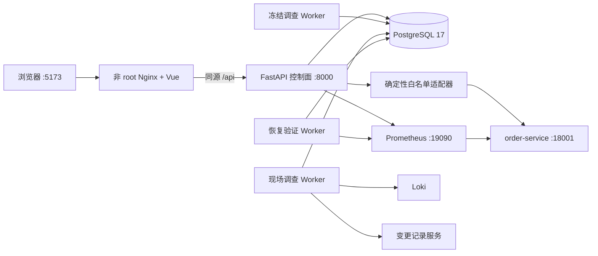

# MVP 一键 Compose 交付与发布验收

## 1. 目标

此前 Compose 已包含 PostgreSQL、故障演练环境、监控日志组件和后台 Worker，但控制面 API 与 Vue 页面仍需在宿主机分别启动。这不利于稳定演示，也无法证明浏览器、API、Worker 和被管环境能以同一份交付定义协同运行。

本切片把控制面与前端加入默认 Compose 拓扑，并建立两个不同用途的验收脚本：无模型的快速运行态检查，以及必须显式确认费用的完整事故闭环演示。

## 2. 运行拓扑



`docker compose up -d --build --wait` 现在会等待数据库迁移、故障环境、控制面和 Web 健康。浏览器只访问 `http://127.0.0.1:5173`；Nginx 把 `/api/` 原路径转发给 `control-api`，并关闭代理缓冲，保证 SSE 事件能够及时到达浏览器。前端 history 路由通过 `index.html` fallback 支持直接打开作战室、审批、执行、验证和治理页面。

## 3. 容器边界

### 3.1 控制面

`control-api` 复用 Python 运行镜像，但使用独立命令启动 FastAPI。数据库、订单演练服务、Prometheus 和 Jaeger 都通过固定 Compose 服务名注入，外部调用方不能在请求中覆盖这些地址。

控制面同时连接 `control` 和 `lab` 网络：前者访问数据库，后者只用于确定性执行器和恢复探针。它不挂载 Docker Socket，也不持有任意 Shell 执行接口。

### 3.2 Web

前端使用两阶段镜像：固定 Node 版本根据 `package-lock.json` 执行 `npm ci` 和生产构建，最终镜像只包含静态文件与非 root Nginx。Node、源码和开发依赖不会进入运行阶段。

控制面与 Web 都满足：

- 主机端口只绑定 `127.0.0.1`；
- 使用非 root 用户；
- 根文件系统只读；
- 删除全部 Linux capabilities；
- 启用 `no-new-privileges`；
- 不挂载宿主机目录或 Docker Socket。

这些是本地演练防护，不等于生产认证、TLS、租户隔离或网络策略。

## 4. 两级验收入口

### 4.1 无模型快速检查

```powershell
.\scripts\verify-mvp.ps1
```

脚本验证控制面、Web 首页、前端 history fallback、同源 API 代理和订单健康状态，随后依次触发版本 500、连接池耗尽和 Redis 不可用。每种故障都必须返回对应稳定错误码，脚本无论成功或失败都会尽力恢复三个安全默认值。

三个基础地址只能设置为 `localhost` 或 `127.0.0.1` 的 HTTP 地址，避免把故障操作误指向外部系统。

### 4.2 完整事故闭环

```powershell
.\scripts\demo-mvp-flow.ps1 -AllowModelCall
```

该脚本会产生真实模型费用，因此没有确认开关时直接拒绝运行。它创建唯一 Incident，并依次完成：

```text
版本故障 → 告警 → 单 Agent 冻结证据调查 → 结构化计划
→ 双人人工审计标识审批 → 白名单回滚 → Prometheus 三样本验证
→ 人工关闭 → 不可变报告 → 未完成改进行动项
```

脚本不读取或输出密钥，模型配置仍只由 Worker 从 `.env` 获取。成功后输出 Incident 引用和作战室地址，产生的业务记录作为本机演示审计事实保留。

## 5. 发布门禁

MVP 发布验收同时要求：

- Ruff 检查与格式检查通过；
- mypy 严格模式通过；
- 完整后端测试通过，包括真实 PostgreSQL 集成测试；
- 完整前端测试、类型检查、生产构建和依赖审计通过；
- Alembic 不存在 ORM 漂移；
- Compose 配置有效，全部默认服务达到预期运行状态；
- 无模型运行态脚本通过并恢复安全默认值；
- 至少一次显式授权的真实模型事故闭环通过。

## 6. 当前限制

- 这是单机本地 Compose 交付，不是生产部署方案。
- 没有登录、RBAC、TLS、租户隔离、WAF 或集中密钥管理。
- 默认 `docker compose up` 会启动现场 Worker，但没有任务时不会调用模型；只有显式创建现场或冻结调查任务才可能产生费用。
- 第一次构建前端镜像需要从 npm 注册表下载锁定依赖，后续构建复用 Docker 缓存。
- 完整演示会向业务库追加真实审计数据，不提供物理删除脚本。

## 7. 面试表达

> 发布验收时我发现原 Compose 只有依赖和 Worker，没有 API 与前端，因此虽然模块都能测试，却不能一键展示。我补了非 root、只读文件系统的控制面和 Nginx 前端容器，用同源反向代理支持普通 REST 与 SSE。验收分为无模型快速检查和显式确认费用的真实事故闭环，后者真实经过模型调查、人工审批、白名单执行、Prometheus 三样本恢复验证、关闭和复盘，证明的不只是接口存在，而是整个状态机能在持久环境中走通。
