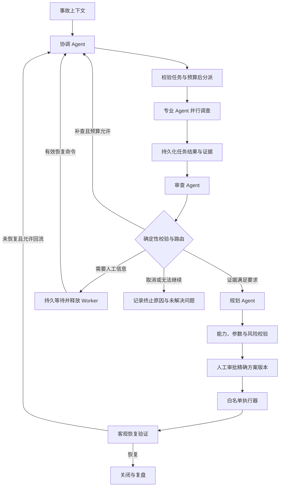

# 完整多 Agent 工程版规划与基础约束

## 1. 决策与交付目标

本决策形成于 2026-09-05。MVP 已完成第 63 步发布验收，第 64 步只确定下一阶段目标与约束，不实现运行时代码。本文中的新增能力均为待开发规划，实际完成情况以 [切片记录](../progress/README.md) 为准。

多 Agent 是既定架构方向，不再通过单 Agent 与多 Agent 对照决定是否继续开发。RAG 项目展示知识摄取、检索与引用能力；OpsSwarm 展示任务分解、专业工具使用、证据协作、动态决策、人工介入、持久化恢复和受控执行。历史单 Agent 路径与评测保留用于兼容和回归，不改写既有数据与实验结论。

完整工程版 v1 的交付标准是：在隔离演练环境中，系统能够动态安排专业调查，审查证据分歧并有界补查；工程师能够补充信息、暂停、恢复和审批；执行后使用客观样本验证恢复，失败时有界重新调查；整个过程可查询、可审计、可重启恢复，并可由新环境中的自动化验收复现。

本版本继续采用模块化单体、独立 Worker、PostgreSQL 业务数据库和独立逻辑 checkpoint 数据库。执行目标限定为本地 Docker Compose 演练环境。生产集群接入、复杂多租户、企业 SSO、计费和插件市场不属于本版本交付范围。

## 2. 当前能力与升级边界

| 领域 | 当前已实现 | 下一阶段待开发 |
| --- | --- | --- |
| 调查编排 | 确定性协调器固定扇出日志、指标、变更三个专业节点 | 根据待解问题选择专业任务并定向补查 |
| 专业分析 | 代码取证后由专业模型生成结构化报告 | 各专业 Agent 在角色工具集内进行多步取证 |
| 证据质疑 | 综合结论后执行一次确定性规则质疑并结束图 | 独立审查 Agent 提出反证和补查建议，代码校验并路由 |
| 持久恢复 | 调查运行、Worker 尝试和 checkpoint；最终调查事实统一提交 | 轮次、专业任务、任务尝试、阶段报告与路由决定持久化 |
| 人工操作 | 审批、执行、关闭等业务 API 与页面 | 调查暂停、取消、人工补充及持久恢复命令 |
| 处置 | 确定性单步骤模板和验证，失败后返回调查状态 | 规划 Agent、多步骤方案及自动创建的有界重新调查 |
| 现场与演示 | 有现场调查记录；完整发布脚本使用真实模型和冻结调查证据 | 动态多 Agent 在真实遥测中完成跨服务事故闭环 |
| 质量与交付 | 版本化三故障评测、单元/集成测试与 Compose | 协作回归场景、CI、浏览器端到端验收、认证与角色权限 |

## 3. 角色、协作与目标流程

| 角色 | 职责 | 结构化输出与权限边界 |
| --- | --- | --- |
| 协调 Agent | 识别待解问题，建议任务分工与下一轮安排 | 任务建议、结束或转人工建议；不能自行突破预算或授予权限 |
| 日志 Agent | 选择受限日志查询，定位异常模式和时间范围 | 日志发现与证据引用；只有日志工具权限 |
| 指标 Agent | 调查异常趋势、影响范围与依赖健康 | 指标发现与证据引用；只有固定范围的指标工具权限 |
| 变更 Agent | 关联部署、配置、代码变更与故障时间 | 变更假设与证据引用；只有允许来源的变更读取权限 |
| 审查 Agent | 检查证据缺口、矛盾与竞争性解释 | 审查意见和补查建议；不能取代确定性证据与安全校验 |
| 规划 Agent | 从已支持结论和能力目录提出处置方案 | 候选动作、前置条件与预期效果；不持有环境写工具 |

上述为六个逻辑角色，专业角色可按任务重复运行。初期一个调查 Worker 承载整张图，专业任务在图内受限并发；不按角色机械拆分进程、独立队列或服务。轮次由协调建议与确定性控制共同推进，Agent 不通过无界自由聊天建立业务事实。

图表示目标主路径；拒绝、过期、执行失败等业务状态继续遵守现有领域规则。新增循环与人工状态在对应切片中定义明确迁移和数据库约束后才实现。

## 4. 基础约束

### 4.1 领域、接口与文件职责

- 保留既有领域模块边界，Agent 编排依赖应用服务和稳定端口，不能跨模块直接修改 ORM 对象。领域规则不依赖模型或框架。
- 每个代码文件承担一个内聚职责，类、函数与前端组件具有单一变更原因。按协议契约、业务策略、应用用例、仓储、模型调用、提示、工具适配、图装配分别组织新增代码。
- 路由只负责 HTTP 输入输出和应用调用；仓储只负责持久化；图文件只负责节点和路由装配；节点通过职责清晰的服务执行工作。禁止把 HTTP、SQL、提示、工具访问和授权判断堆入同一文件。
- 前端页面负责组合视图，组件处理局部交互，状态存储协调状态与请求，服务模块封装 API/SSE；权限和业务真值由后端控制。
- 不规定机械文件行数，不要求一文件一函数，也不提前生成空目录或抽象层。对已有大文件仅在当前切片需要新增独立职责时提取边界，保留行为并进行相应回归。

### 4.2 业务事实与共享上下文

- 区分 Incident、调查运行、调查轮次、专业任务、任务执行尝试和处置执行。补查生成新任务；技术重试保留任务身份并生成新尝试，不能混淆为同一次工作。
- 任务输入、角色、允许工具、状态、专业结果、关键路由决定与人工输入显式落库。物理表、字段和公开接口在对应切片中更新数据库/API 设计，本次不预建表或接口。
- 阶段性报告是可追踪的调查材料；只有满足完整性和支持条件后，才发布可用于处置计划的调查结论。页面不能把未完成报告当作已确认根因。
- checkpoint 只负责恢复快照。节点可能被再次执行，业务写入使用稳定任务身份幂等提交；业务库与 checkpoint 不假设跨库原子提交，恢复时核对已提交结果，拒绝冲突内容。
- 共享上下文使用有界结构化发现、证据引用及必要摘要。原始证据保留来源、采集时间、所属任务和查询范围；摘要不能改写原始事实或产生新证据引用。
- 跨轮复用必须检查服务范围、时间与执行前后状态。后续观察以追加记录表达，不覆盖旧证据；版本冲突和证据过期要显式标记并触发补查或停止。
- 现场来源失败记录为来源错误或证据缺口，不能混入冻结证据，也不能当作系统健康。现场证据与外部文本按不可信输入处理，不能改变角色权限或系统规则。

### 4.3 决策、工具与资源预算

- 模型输出经 Pydantic 验证后，代码再次校验任务角色、依赖、目标、证据引用和工具参数。模型只能建议，不能自行修改权限、预算与状态。
- 专业工具分别限定服务、来源、时间窗、返回大小与超时；执行工具只属于确定性执行器。新增工具必须有明确权限、输入契约和失败语义。
- 调查轮数、任务总数、单任务工具调用数、并发数、上下文大小和总时长均有上限。首版动态调查默认最多三轮、最多三个专业任务并发；其他数值在引入对应能力的切片中确定并验证，再随运行冻结。
- 总预算覆盖补查和重试，不能在新一轮或任务接管时清零。费用使用价格快照与实际 usage 估算，调用前预留并发预算，结算后更新；不能声称它是供应商硬性扣费上限。
- 达到上限、无新证据或无法处理分歧时，由代码停止自动调查并持久化原因；需要补充信息则进入人工等待，不能无限循环或绕过质疑直接生成可执行计划。
- 异步节点禁止直接调用阻塞网络客户端；已有同步适配器采用受限线程执行或异步端口。取消线程等待不等于中断底层 HTTP，必须有客户端超时，并拒绝迟到结果。

### 4.4 恢复、人工介入与版本

- 继续使用至少一次任务处理、租约令牌和过期检查。领取、业务结算和进度事件保持事务一致，旧 Worker 和取消后的迟到结果不得推进状态。
- 多轮调查不能直接套用当前单次处理时限。引入时明确轮次或任务结算边界、执行超时和租约关系；等待人工时提交状态、释放 Worker，不在进程中长期挂起。
- 暂停与取消在安全边界生效，不再派发新任务；不能承诺撤销已产生的模型费用或外部动作。已在执行的白名单动作仍须结算审计与真实结果。
- 人工补充保存来源、时间和关联运行；恢复、取消、补充命令校验当前状态、版本和幂等键。有效恢复命令与待处理任务原子持久化，重复提交只恢复一次。
- 运行固定工作流、提示、输出契约、数据源和预算策略版本。保留当前工作流 v1，新增协作图使用独立 v2；无法兼容的旧 checkpoint 明确拒绝恢复，不能静默套用新图。
- 重启恢复保留运行身份；因新证据或处置失败重新调查则明确记录前序运行或轮次关系和回流次数，不能重用不适用的旧结论。

### 4.5 审批、处置与安全

- 规划 Agent 从能力目录生成候选方案；参数来源、前置条件、风险和验证判据由代码校验或确定。浏览器和模型不能提交任意 Shell、SQL、URL 或验证阈值绕过服务端规则。
- 审批绑定精确方案版本与内容摘要。新增信息改变执行依据或计划内容后，重新确认计划有效性并使相关旧审批失效；任何自动修订不能沿用旧授权。
- 多步骤处置先从单步骤能力演进，逐步定义依赖、步骤结果、失败停止及重新审批。补偿和恢复动作也受能力白名单与有效授权约束，不自动假定所有动作可回滚。
- 验证样本继续由确定性探针取得；未恢复时持久化样本和已执行动作，再受预算与状态规则控制创建下一次调查。重复无效方案不得无限执行。
- 当前调用方 `actor_id` 仅是本地审计标识。身份阶段完成后，操作者和权限以服务端认证结果为准，未认证请求与越权动作必须拒绝；该能力也不等于已完成生产安全建设。
- 审计与观测分离，SSE 先落库再推送；界面展示任务、工具记录、证据关系和简短决策说明，不把模型内部思维链作为产品功能或审计依赖。

## 5. 六阶段路线与验收

| 阶段 | 小切片推进顺序 | 阶段验收 |
| --- | --- | --- |
| 一：协作运行底座 | 轮次与专业任务契约及持久化 → 当前固定图接入任务事实与事件 → 异步取证、幂等和恢复 | 固定三专业流程可查询中间进度；重复节点结算一次；重启恢复不丢已提交事实 |
| 二：动态调查协作 | 协调 Agent 与任务校验 → 专业工具循环 → 独立审查 Agent → 定向补查与预算终止 | 第一轮证据不足时第二轮只补查需要的专业；矛盾不能直接放行；三轮上限生效 |
| 三：人工介入与处置 | 暂停/取消/补充/恢复 → 单步骤规划 Agent → 多步骤计划与失败停止 → 验证失败有界回流 | 等待释放 Worker；重复恢复幂等；新计划需新审批；部分执行失败和恢复失败均可追踪 |
| 四：复杂现场场景 | 动态图真实现场闭环 → 网关与订单依赖场景 → 干扰变更 → 复合故障与证据时序 | 真实遥测支持至少一个跨服务事故和一个需要重新调查的事故；演练结束恢复安全状态 |
| 五：协作工作台与权限 | 任务/轮次视图 → 分歧与证据关系 → 人工介入页面 → 认证和角色权限 → 成本与运行回放 | 浏览器可理解、干预和审计全过程；身份来自服务端，越权拒绝，刷新与 SSE 重连可恢复显示 |
| 六：质量与发布 | 协作场景集 → CI → 浏览器端到端流程 → 故障恢复发布验收 → 部署说明与演示资料 | 新环境可部署，离线验收可重复，显式授权的真实模型现场演示通过 |

复杂现场场景首先使用“网关超时、订单服务有无关发布、实际 Redis 连接异常”，让专业报告通过跨服务证据和反证消除误判。随后增加故障先后发生、一次处置仅部分恢复、数据源不可用及旧证据冲突；连接池演练逐步引入真实负载和真实连接池行为。

协作工作台的后端进度接口在阶段一同步建立，完整交互页面在阶段五完成；各阶段保留可调用接口或脚本作为独立验收入口。每个阶段可包含多个独立切片，不以阶段为单位一次性实现或提交。

## 6. 下一批切片与接口演进

第 64 步为本次文档决策。下一批按依赖顺序推进，编号随实际独立提交递增，不预先宣布完成：

1. 设计并实现调查轮次与专业任务的最小领域模型、数据库迁移和只读查询；明确状态、幂等身份与失败路径，覆盖真实 PostgreSQL 并发和重复提交。
2. 将现有固定并行流程接入任务记录和进度事件，修复阻塞取证，验证 checkpoint 与业务结果重复结算。保留当前最终调查结果及 API 兼容行为。
3. 增加动态协调和确定性任务校验，让已有专业角色按选定任务运行，覆盖非法角色、越权工具、重复任务与预算拒绝。
4. 逐个引入专业工具循环及独立审查，再以“第一轮缺失证据、第二轮只补查一个专业任务”的固定场景打通多轮最小闭环。

公开接口按能力逐步增加轮次/任务查询、阶段事件以及暂停、取消、补充、恢复命令；不在本切片预建路由或给既有接口静默增加新语义。改变状态、结构或协议时，先更新 [数据库设计](04-database-design.md) 与 [API 设计](05-api-design.md)，再迁移和实现；新的字段与响应必须区分未完成材料和已确认结论。

继续使用当前 LangChain、LangGraph、PostgreSQL、OpenTelemetry、Prometheus/Loki 和 Vue/SSE。MCP 只读工具服务可在工具边界稳定后作为独立可选集成切片，不属于完整工程版的必选验收项；新增协议仍复用原权限与数据校验，不扩大执行权限。

## 7. 质量门禁与完成判据

- 纯单元测试验证任务路由、角色权限、证据引用、预算、循环终止、状态和确定性风险规则。
- 真实 PostgreSQL 集成测试覆盖任务竞争、幂等结算、租约失效、取消后迟到结果、业务事实与 checkpoint 恢复、人工等待和重复恢复。
- Agent 测试使用假模型与固定工具结果，覆盖无关变更、冲突证据、缺失来源、未知故障和工具输出中的恶意指令；质量验收不以单、多 Agent 收益对比为前提。
- 前端与端到端测试覆盖任务进度、人工补充、审批、执行、恢复验证及 SSE 断线重连。API 和静态检查按各切片风险执行，CI 不依赖外部模型凭据。
- 发布验收分别记录冻结回归和真实现场结果；真实调用须显式授权并受预算约束。记录调查结果、分歧处理、补查有效性、恢复成功率、耗时、工具调用、Token 和估算费用。
- 每个切片检查文件职责、依赖方向、状态/接口/持久化/失败路径、相应测试与 `git diff --check`，更新一篇进度记录并创建独立中文提交。
- 最终交付必须具备动态多轮调查、人工恢复、失败回流、真实现场演示和可复现部署的验收证据；尚未验收的能力只能标注为规划，不能写成简历中的已完成成果。
