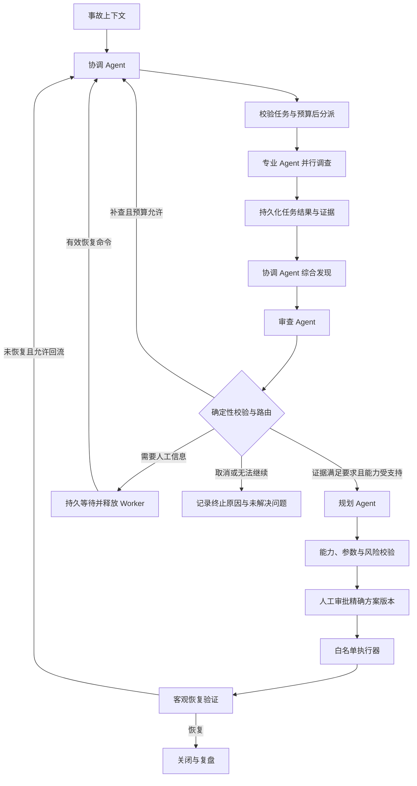

# 完整多 Agent 工程版规划与基础约束

## 1. 决策与交付目标

本决策形成于 2026-09-05，第 65 步结合 [Agent 系统最终设计](65-agent-system-design.md) 更新开发顺序与协议选择。MVP 已完成第 63 步发布验收，第 64、65 步均为文档决策；第 66 步交付任务持久化底座，第 67 步将 [冻结 v2 固定图接入专业任务、结果与事件](67-fixed-graph-task-integration.md)，第 68 步加入 [调用次数与时限共享预算](68-shared-call-budget.md)，第 69 步增加显式 [模型输入与费用预算](69-model-input-budget.md)。路线表描述最终交付目标，实际完成情况以 [切片记录与当前推进位置](../progress/README.md) 为准。

多 Agent 是既定架构方向，不再通过单 Agent 与多 Agent 对照决定是否继续开发。RAG 项目展示知识摄取、检索与引用能力；OpsSwarm 展示任务分解、专业工具使用、证据协作、动态决策、人工介入、持久化恢复和受控执行。历史单 Agent 路径与评测保留用于兼容和回归，不改写既有数据与实验结论。

首个完整工程版的交付标准是：在隔离演练环境中，系统能够动态安排专业调查，通过任务隔离的上下文、可追溯经验与手册辅助调查，审查证据分歧并有界补查；现场日志和指标经只读 MCP 获取；工程师能够补充信息、暂停、恢复和审批；执行后使用客观样本验证恢复，失败时有界重新调查；整个过程可查询、可审计、可重启恢复，并可由新环境中的自动化验收复现。产品交付阶段与工作流版本分开命名，保留当前工作流 v1，新增协作图使用 v2。

本版本继续采用模块化单体、独立 Worker、PostgreSQL 业务数据库和独立逻辑 checkpoint 数据库。执行目标限定为本地 Docker Compose 演练环境。生产集群接入、复杂多租户、企业 SSO、计费、插件市场和通用代码执行沙箱不属于本版本交付范围。

## 2. 当前能力与升级边界

| 领域 | 当前已实现 | 下一阶段待开发 |
| --- | --- | --- |
| 调查编排 | 确定性协调器固定扇出日志、指标、变更三个专业节点 | 根据待解问题选择专业任务并定向补查 |
| 专业分析 | 固定图先保存取证快照；第 79 步新策略支持专业模型从目录按需读取已存证据并提交报告 | 各专业 Agent 动态选择角色工具执行现场补查 |
| 证据质疑 | 综合结论后执行一次确定性规则质疑并结束图 | 独立审查 Agent 提出反证和补查建议，代码校验并路由 |
| 持久恢复 | 调查运行、Worker 尝试和 checkpoint；v2 固定图保存任务、结果及协作事件，新运行预留调用次数并限制总时限，可显式启用输入/输出 Token 与估算费用预算；第 71 步在模型前提交取证快照，第 73 步将固定窗口、异步来源和快照恢复接入现场 v2，技术重试复用同任务材料；第 75 步为新建并启用模型预算的 v2 保存任务上下文清单 | 动态路由决定与图内人工恢复 |
| 记忆与上下文 | 已有证据与复盘报告；第 75 步 ContextBuilder 隔离任务输入；第 79 步专业按需读取新策略保存目录、完整配对交互和逐次预算清单；第 80 步生成可查询的不可变任务工作摘要 | 摘要上下文消费、已确认经验、调查手册和人工约束输入 |
| 工具接入 | 日志、指标、变更及 GitHub 只读适配器；第 70 步多 Agent Worker 通过受限异步线程桥接取证 | 角色能力工具入口与日志/指标只读 MCP |
| 人工操作 | 审批、执行、关闭等业务 API 与页面 | 调查暂停、取消、人工补充及持久恢复命令 |
| 处置 | 确定性单步骤模板和验证，失败后返回调查状态 | 规划 Agent、多步骤方案及自动创建的有界重新调查 |
| 现场与演示 | 有现场调查记录；完整发布脚本使用真实模型和冻结调查证据 | 动态多 Agent 在真实遥测中完成跨服务事故闭环 |
| 质量与交付 | 版本化三故障评测、单元/集成测试与 Compose | 协作回归场景、CI、浏览器端到端验收、认证与角色权限 |

## 3. 角色、协作与目标流程

| 角色 | 职责 | 结构化输出与权限边界 |
| --- | --- | --- |
| 协调 Agent | 识别待解问题，分解任务、综合专业发现并建议下一轮安排 | 任务建议、综合判断、结束或转人工建议；不能突破预算或授予权限 |
| 日志 Agent | 选择受限日志查询，定位异常模式和时间范围 | 日志发现与证据引用；只有日志工具权限 |
| 指标 Agent | 调查异常趋势、影响范围与依赖健康 | 指标发现与证据引用；只有固定范围的指标工具权限 |
| 变更 Agent | 关联部署、配置、代码变更与故障时间 | 变更假设与证据引用；只有允许来源的变更读取权限 |
| 审查 Agent | 检查证据缺口、矛盾与竞争性解释 | 审查意见和补查建议；不能取代确定性证据与安全校验 |
| 规划 Agent | 从已支持结论和能力目录提出处置方案 | 候选动作、前置条件与预期效果；不持有环境写工具 |

上述为六个逻辑角色，专业角色可按任务重复运行。初期一个调查 Worker 承载整张图，专业任务在图内受限并发；不按角色机械拆分进程、独立队列或服务。轮次由协调建议与确定性控制共同推进，Agent 不通过无界自由聊天建立业务事实。

业务边界固定，调查路径动态。专业角色可输出跨专业补查请求，由协调器分派；首版不开放递归创建 Agent 的通用工具。未知根因通过新增假设描述、支持证据、反证和待验证问题表达，不能强制映射到已知故障来获得执行资格；审查通过不代表根因已被客观证明。

图表示目标主路径；拒绝、过期、执行失败等业务状态继续遵守现有领域规则。新增循环与人工状态在对应切片中定义明确迁移和数据库约束后才实现。

## 4. 基础约束

### 4.1 领域、接口与文件职责

- 保留既有领域模块边界，Agent 编排依赖应用服务和稳定端口，不能跨模块直接修改 ORM 对象。领域规则不依赖模型或框架。
- 每个代码文件承担一个内聚职责，类、函数与前端组件具有单一变更原因。按协议契约、业务策略、应用用例、仓储、模型调用、提示、工具适配、图装配分别组织新增代码。
- 路由只负责 HTTP 输入输出和应用调用；仓储只负责持久化；图文件只负责节点和路由装配；节点通过职责清晰的服务执行工作。禁止把 HTTP、SQL、提示、工具访问和授权判断堆入同一文件。
- 前端页面负责组合视图，组件处理局部交互，状态存储协调状态与请求，服务模块封装 API/SSE；权限和业务真值由后端控制。
- 不规定机械文件行数，不要求一文件一函数，也不提前生成空目录或抽象层。对已有大文件仅在当前切片需要新增独立职责时提取边界，保留行为并进行相应回归。

### 4.2 业务事实与共享上下文

分层记忆、上下文材料与版本追溯以 [专项设计](65-agent-system-design.md) 第 3～4 节为准。工作记忆、事故共享事实、已确认经验、Git 调查手册与 checkpoint 各有职责；开发用 `AGENTS.md` 不作为业务 Agent 的运行时记忆。上下文按任务隔离、按需读取，不能自动共享全部角色聊天记录。

- 区分 Incident、调查运行、调查轮次、专业任务、任务执行尝试和处置执行。补查生成新任务；技术重试保留任务身份并生成新尝试，不能混淆为同一次工作。
- 任务输入、角色、允许工具、状态、专业结果、关键路由决定与人工输入显式落库。物理表、字段和公开接口在对应切片中更新数据库/API 设计，本次不预建表或接口。
- 阶段性报告是可追踪的调查材料；只有满足完整性和支持条件后，才发布可用于处置计划的调查结论。页面不能把未完成报告当作已确认根因。
- checkpoint 只负责恢复快照。节点可能被再次执行，业务写入使用稳定任务身份幂等提交；业务库与 checkpoint 不假设跨库原子提交，恢复时核对已提交结果，拒绝冲突内容。
- 共享上下文使用有界结构化发现、证据引用及必要摘要。原始证据保留来源、采集时间、所属任务和查询范围；摘要不能改写原始事实或产生新证据引用。
- 跨轮复用必须检查服务范围、时间与执行前后状态。后续观察以追加记录表达，不覆盖旧证据；版本冲突和证据过期要显式标记并触发补查或停止。
- 现场来源失败记录为来源错误或证据缺口，不能混入冻结证据，也不能当作系统健康。现场证据与外部文本按不可信输入处理，不能改变角色权限或系统规则。

### 4.3 决策、工具与资源预算

- 模型输出经 Pydantic 验证后，代码再次校验任务角色、依赖、目标、证据引用和工具参数。模型只能建议，不能自行修改权限、预算与状态。
- 专业工具分别限定服务、来源、时间窗、返回大小与超时；执行工具只属于确定性执行器。新增工具必须有明确权限、输入契约和失败语义。
- 调查轮数、任务总数、模型调用、单任务工具调用数、并发数、上下文大小和总时长均有上限。首版动态调查默认最多三轮、三个专业任务并发、每个专业任务最多六次工具调用；其他数值在对应切片中确定并验证，再随运行冻结。模型窗口须预留输出和安全余量，必要内容仍超限时停止调用。
- 总预算覆盖补查和重试，不能在新一轮或任务接管时清零。费用使用价格快照与实际 usage 估算，调用前预留并发预算，结算后更新；不能声称它是供应商硬性扣费上限。
- 未知模型用量保持未知，不记为零，不承诺模型恰好调用一次；人工恢复和验证失败回流不能重置预算，追加预算须保存新的可审计控制决定。
- 达到上限、无新证据或无法处理分歧时，由代码停止自动调查并持久化原因；需要补充信息则进入人工等待，不能无限循环或绕过质疑直接生成可执行计划。
- 异步节点禁止直接调用阻塞网络客户端；已有同步适配器采用受限线程执行或异步端口。取消线程等待不等于中断底层 HTTP，必须有客户端超时，并拒绝迟到结果。

### 4.4 恢复、人工介入与版本

- 继续使用至少一次任务处理、租约令牌和过期检查。领取、业务结算和进度事件保持事务一致，旧 Worker 和取消后的迟到结果不得推进状态。
- 多轮调查不能直接套用当前单次处理时限。引入时明确轮次或任务结算边界、执行超时和租约关系；等待人工时提交状态、释放 Worker，不在进程中长期挂起。
- 暂停与取消在安全边界生效，不再派发新任务；不能承诺撤销已产生的模型费用或外部动作。已在执行的白名单动作仍须结算审计与真实结果。
- 人工补充保存来源、时间和关联运行；恢复、取消、补充命令校验当前状态、版本和幂等键。有效恢复命令与待处理任务原子持久化，重复提交只恢复一次。
- 运行固定工作流、角色、工具、提示、输出契约、上下文、数据源和预算策略版本。保留当前工作流 v1，新增协作图使用独立 v2；无法兼容的旧 checkpoint 明确拒绝恢复，不能静默套用新图。
- 重启恢复保留运行身份；因新证据或处置失败重新调查则明确记录前序运行或轮次关系和回流次数，不能重用不适用的旧结论。

### 4.5 审批、处置与安全

- 规划 Agent 从能力目录生成候选方案；参数来源、前置条件、风险和验证判据由代码校验或确定。浏览器和模型不能提交任意 Shell、SQL、URL 或验证阈值绕过服务端规则。
- 审批绑定精确方案版本与内容摘要。新增信息改变执行依据或计划内容后，重新确认计划有效性并使相关旧审批失效；任何自动修订不能沿用旧授权。
- 多步骤处置先从单步骤能力演进，逐步定义依赖、步骤结果、失败停止及重新审批。补偿和恢复动作也受能力白名单与有效授权约束，不自动假定所有动作可回滚。
- 验证样本继续由确定性探针取得；未恢复时持久化样本和已执行动作，再受预算与状态规则控制创建下一次调查。重复无效方案不得无限执行。
- 当前调用方 `actor_id` 仅是本地审计标识。经验审核前必须具备最小可信身份，操作者和权限以服务端认证结果为准，未认证请求与越权动作必须拒绝；该能力也不等于已完成生产安全建设。
- 审计与观测分离，SSE 先落库再推送；界面展示任务、工具记录、证据关系和简短决策说明，不把模型内部思维链作为产品功能或审计依赖。

## 5. 最终开发顺序与验收

第 65 步用以下顺序替代最初六阶段安排，把上下文、MCP 和经验记忆纳入明确交付依赖，并将可信身份前置到经验审核之前。序号不是提交编号；详细设计与必测场景见 [专项设计](65-agent-system-design.md)。

| 顺序 | 交付内容 | 主要完成标志 |
| --- | --- | --- |
| 1 | 最终架构决策落盘（第 65 步文档切片） | 长期规则、专项设计与总路线一致，明确已实现和待开发 |
| 2 | 轮次、专业任务及尝试持久化 | 并发、幂等、状态和失败路径可测试 |
| 3 | 固定图接入任务事实与最小 Harness | 中间过程可查询，预算前置，异步取证与恢复正确 |
| 4 | 上下文管理与证据按需读取 | 任务隔离、摘要、上下文清单和输入预算生效 |
| 5 | 动态专业调查与开放假设 | 专业工具循环、协调综合、跨专业补查、独立审查与有界循环 |
| 6 | 只读遥测 MCP | v2 现场调查实际通过 MCP 获取日志和指标 |
| 7 | 调查手册、可信身份与经验记忆 | 候选提取、人工审核、检索、停用与版本追踪闭环 |
| 8 | 人工介入与规划 Agent | 暂停恢复、补充信息、候选方案与审批绑定 |
| 9 | 多步骤处置与验证失败回流 | 部分失败停止、真实验证、重新调查与重复处置限制 |
| 10 | 复杂现场场景与协作工作台 | 跨服务与复合事故可演示，页面能解释并干预全过程 |
| 11 | CI、端到端验收与发布 | 新环境可部署，离线回归与真实现场演示可复现 |

复杂现场场景首先使用“网关超时、订单服务有无关发布、实际 Redis 连接异常”，让专业报告通过跨服务证据和反证消除误判。随后增加故障先后发生、一次处置仅部分恢复、数据源不可用及旧证据冲突；连接池演练逐步引入真实负载和真实连接池行为。

必要查询接口随功能同步交付，完整交互页面在后续对应阶段完成；各阶段保留可调用接口或脚本作为独立验收入口。每行可包含多个独立切片，不一次性实现或提交整个阶段。CI 在发布阶段汇总，各切片的测试、静态检查和进度记录持续执行。

## 6. 下一批切片与接口演进

第 72 步完成 [现场来源显式观测窗口](72-explicit-observation-windows.md)：本地日志、指标与历史变更使用固定范围，历史查询不混入当前运行清单。第 73 步完成 [现场 v2 任务接入](73-live-task-evidence.md)，固定运行窗口和现场材料策略，并通过异步适配器复用已提交快照；GitHub 组合源明确拒绝，历史变更不混入当前运行清单。第 74 步修复 [冻结身份的跨进程确定性与历史任务兼容](74-stable-frozen-identity.md)，使用不同哈希种子的独立 Worker 进程验证恢复；未知旧内容拒绝自动沿用身份。第 75 步接入 [最小 ContextBuilder、不可变材料清单与预算](75-task-context-builder.md)，历史策略保留。第 76 步增加 [证据目录与单条详情读取服务/API](76-context-evidence-reader.md)，仍未改变模型输入。第 77 步先补齐 [同一尝试内重复调用的持久身份](77-repeated-call-identity.md)，保留旧幂等键并共享运行预算。第 79 步接入有界模型按需读取、新上下文策略和工具消息配对；第 80 步生成不可变工作摘要材料，下一片设计摘要上下文消费及完整配对裁剪，再推进动态协调。下段保留此前各前置切片的完成边界。

第 64 步确定总方向，第 65 步统一专项设计与本路线。第 66 步完成下列第 1 项，第 67 步完成第 2 项中的冻结固定图接入、专业结果/事件与恢复核对，第 68 步加入运行级次数与时限预算。第 69 步完成显式模型输入预算、SDK 输出上限及共享估算费用预留。第 70 步完成 [受限异步取证](70-bounded-async-evidence.md)，验证线程真实并发、超时/取消后容量保留和迟到结果拒绝。第 71 步完成 [模型调用前的专业取证快照与恢复复用](71-task-evidence-snapshot.md)，先在冻结 v2 验证独立材料提交。来源侧显式时间窗由第 72 步补齐，第 73 步完成现场 v2 的任务接入，下一步依序推进上下文管理。每项仍可拆成多个独立提交：

1. 设计并实现调查轮次、专业任务及尝试的最小领域模型、数据库迁移和必要只读查询；明确状态、幂等身份、租约与失败路径，覆盖真实 PostgreSQL 并发和重复提交。
2. 将现有固定并行流程接入任务记录和进度事件，引入最小 Harness 与调用前预算预留，修复阻塞取证，验证 checkpoint 和业务结果重复结算；保留当前最终调查结果及 API 兼容行为。
3. 增加任务上下文组装、证据按需读取、结构化工作摘要和上下文清单，验证隔离、关键材料保留与输入预算。
4. 逐个引入动态协调、专业工具循环、开放假设和独立审查，再以“第一轮缺失证据、第二轮只补查一个专业任务”打通有界闭环。

公开接口按能力逐步增加轮次/任务查询、上下文清单、阶段事件、暂停/取消/补充/恢复和经验审核命令；不在本切片预建路由或给既有接口静默增加新语义。改变状态、结构或协议时，先更新 [数据库设计](04-database-design.md) 与 [API 设计](05-api-design.md)，再迁移和实现；新的字段与响应必须区分未完成材料和经过审查的判断，保留未知假设及历史 API 兼容性。

继续使用 LangChain、LangGraph、PostgreSQL、OpenTelemetry、Prometheus/Loki 和 Vue/SSE，增加项目内部轻量 Harness，不重复实现框架能力。内部协作使用结构化任务与结果，当前不引入 A2A。日志、指标只读 `telemetry-mcp` 是本版本已决定的必选交付切片，取代第 64 步最初“MCP 可选”的决定；它复用原权限与数据校验，不扩大执行权限。工具清单、MCP 服务边界、经验生命周期及上下文规则统一见第 65 篇专项设计。

## 7. 质量门禁与完成判据

- 纯单元测试验证任务路由、角色权限、证据引用、预算、循环终止、状态和确定性风险规则。
- 真实 PostgreSQL 集成测试覆盖任务竞争、幂等结算、租约失效、取消后迟到结果、业务事实与 checkpoint 恢复、人工等待和重复恢复。
- Agent 测试使用假模型与固定工具结果，覆盖无关变更、冲突证据、缺失来源、未知故障和工具输出中的恶意指令；质量验收不以单、多 Agent 收益对比为前提。
- 上下文与经验测试覆盖事故隔离、长日志裁剪、工具消息配对、未确认/停用经验排除和不可变引用；MCP 测试覆盖超时、非法响应和禁止冻结回退。
- 前端与端到端测试覆盖任务进度、人工补充、审批、执行、恢复验证及 SSE 断线重连。API 和静态检查按各切片风险执行，CI 不依赖外部模型凭据。
- 发布验收分别记录冻结回归和真实现场结果；真实调用须显式授权并受预算约束。记录调查结果、分歧处理、补查有效性、恢复成功率、耗时、工具调用、Token 和估算费用。
- 每个切片检查文件职责、依赖方向、状态/接口/持久化/失败路径、相应测试与 `git diff --check`，更新一篇进度记录并创建独立中文提交。
- 最终交付必须具备动态多轮调查、上下文管理、经验记忆、MCP、人工恢复、失败回流、真实现场演示和可复现部署的验收证据。能力状态区分已决定、开发中与已验收，不能把尚未验收的规划写成简历中的已完成成果。
