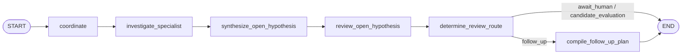

# v3 确定性补查计划与第二轮任务持久化

## 目标与边界

本片消费第 90 步已经持久化的 `follow_up` 路由，把其中全部补查建议编译为第二轮协调计划、业务轮次和待执行专业任务。编译过程不调用协调模型，也不允许调用方补充角色、服务、窗口、快照、任务数或尝试上限。

本片只创建第二轮。任务保持 `pending`，轮次保持 `running`，父调查运行继续 `running`。第二轮专业调查、再次综合与审查、多轮循环、`await_human` 的图内暂停、`candidate_evaluation` 的候选结论、规划和处置均不在本片实现。

## 确定性编译

只有通过来源重建的 `follow_up` 路由可以进入编译。系统完整消费建议，不截断、不挑选、不增加任务，并按 `role.value` 稳定排序：

| 路由建议 | 第二轮计划字段 |
| --- | --- |
| `role` | `task_key=role.value` 与任务 `role` |
| `question` | 任务 `goal` |
| `rationale` | 保留在不可变路由事实，通过来源引用读取，不复制进计划 |
| 建议集合 | 第二轮全部任务；角色仍保持一轮内唯一 |

轮次号固定为 2，轮次目标固定为“补查独立审查指出的证据缺口”。日志和指标任务回看 900 秒，变更任务回看 21600 秒；截止时间和证据快照沿用首轮协调计划，服务名来自事故，最大尝试次数来自运行固定的 `dynamic-coordination-v1` 策略。

保存前再次执行协调计划编译器，复核轮次、单轮任务数、总任务数、角色权限、时间窗和冻结快照。路由决定时虽然已经检查容量，提交时仍从数据库重新统计，防止并发或来源漂移绕过上限。

## 持久化与来源

复用 `investigation_coordination_plans`，新增可空 `source_review_route_id`。首轮模型计划使用 `source_call_id`，第二轮补查计划使用 `source_review_route_id`，两者最多一个非空；历史无模型来源计划允许两者都为空。复合外键绑定同一运行的审查路由，唯一约束保证一条路由最多派生一份计划。

读取第二轮计划时依次重建：

1. 计划、第二轮、任务、父尝试和固定协调策略；
2. `source_review_route_id` 对应的审查路由、独立审查和开放假设；
3. 路由所属首轮协调计划及其统一冻结快照和截止时间；
4. 由完整补查建议重新编译的第二轮提案与分派。

任何运行、轮次、策略散列、路由类型、建议、窗口、快照、任务或时间顺序不一致都拒绝返回。计划、第二轮、全部任务和 `round.created` 事件在同一有效父租约事务提交；业务事实表继续拒绝更新和删除。

迁移 `0048_follow_up_planning` 增加计划来源列、同运行复合外键、来源唯一与互斥约束，并发布图 v6。存在图 v6 运行或路由派生计划时拒绝降级到 `0047`。

## 图版本与恢复

图 v5 已有终态 checkpoint，因此固定为历史路由图。新运行使用图 v6：

图 v1～v5 保留各自恢复语义。综合事实允许图 v3～v6，审查事实允许图 v4～v6，路由事实允许图 v5～v6，补查计划只允许图 v6。通用 Worker 继续不领取 v3。

本片没有新的外部调用窗口。路由已保存、计划事务提交前失败时，恢复重新运行纯编译；计划、轮次和任务已提交但 checkpoint 未写入时，恢复按来源唯一键复用原计划；最终返回前仍从业务库重建全部来源。旧租约失效或提交前到期时，计划、轮次、任务和事件整体回滚。

## 验收标准

- 领域测试证明全部建议按稳定顺序映射，角色窗口由系统注入，非补查路由和非首轮来源被拒绝。
- 真实 PostgreSQL 验证计划、第二轮、任务和事件原子提交，路由来源同运行且唯一，查询能够从完整业务来源重建。
- 图 v6 覆盖三种路由、计划保存前失败和计划提交后 checkpoint 前失败，证明恢复不新增模型或工具调用。
- 第二轮任务保持待执行，父运行不结算；图 v1～v5 checkpoint、启动/API、Worker 隔离与迁移升降级继续兼容。
