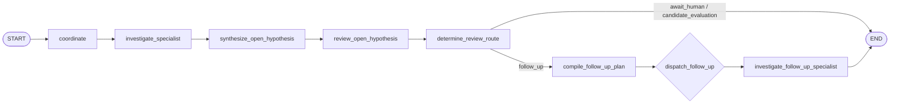

# v3 第二轮专业任务执行与恢复

实现状态：第 92 步已按本文边界验收。图 v7 已执行持久化第二轮计划，图 v1～v6 保留历史恢复语义；统一验收证据见 [第 92 步进度记录](../progress/92-second-round-investigation.md)。

## 目标与业务边界

第 91 步已经把首轮独立审查的 `follow_up` 路由确定性编译为第二轮协调计划、业务轮次和待执行任务。本片只执行这份已持久化计划，使第二轮任务产生可查询的尝试、证据、专业结果和工作摘要，并验证并行部分完成及业务提交与 checkpoint 之间的恢复语义。

图不能从 checkpoint 中的临时对象扩大分派范围。第二轮角色、目标、服务、时间窗、证据快照和尝试上限全部来自重新验证通过的持久计划；`await_human` 与 `candidate_evaluation` 仍直接结束当前图路径。第二轮全部完成后父调查运行继续保持 `running`，等待后续切片再次综合与审查。

本片不再次综合、审查或路由，不创建第三轮，不实现 LangGraph 人工暂停、补充、取消或恢复，不生成候选结论或处置计划，不接入 MCP，也不让通用 Worker 领取 v3。

## 图状态与结果契约

首轮和第二轮允许出现相同专业角色，而 `SpecialistTaskResult` 本身不携带任务或轮次身份。因此图 v7 必须使用独立的 `follow_up_results` reducer 保存第二轮结果，不能把它们追加到首轮 `specialist_results`。这样 checkpoint 恢复和最终业务复核都能明确区分两轮材料，避免按角色去重时覆盖或误认。

新增 `FollowUpExecutionResult`，在第 91 步 `FollowUpPlanningResult` 上增加第二轮结果：

- `follow_up` 路由必须同时存在来源一致的第二轮计划，以及与计划任务一一对应的 1～3 份第二轮专业结果；角色集合、数量和冻结快照必须完全匹配。
- `await_human` 与 `candidate_evaluation` 既不能携带第二轮计划，也不能携带第二轮结果。
- 最终返回前必须按第二轮 `round_id` 和完整 `TaskAssignment` 从业务库逐项读取成功结果，再与 checkpoint 中独立的 `follow_up_results` 比较；checkpoint 不能替代任务结果事实。

第二轮分派按持久计划中的 `task_key` 稳定排序。图节点只接收计划中已有的 `round_id` 和完整分派，不接受调用方另传角色、窗口或快照。

## 专业任务执行

第二轮继续复用现有专业执行链：

1. 以有效父租约和稳定任务身份取得新的任务尝试。
2. 在分派窗口内读取同一冻结场景来源，并把材料保存为该第二轮任务自己的不可变证据快照。
3. 通过现有 `EvidenceLoopAnalyst`、任务隔离上下文和受限证据读取生成结构化专业报告。
4. 每次外部调用按调用账本结算用量；专业角色与证据引用校验通过后，在任务结算事务中原子保存结果、工作摘要和任务事件，并推进轮次状态。

`DynamicTaskRuntime` 的任务查询必须显式接收期望轮次。首轮节点传入 `expected_round_number=1`，第二轮节点传入 `expected_round_number=2`；运行器同时校验运行、`round_id`、轮次号、任务键、完整分派和证据快照。不能把原有“只接受首轮”直接放宽为接受任意轮次，否则错误图节点可能执行其他已持久化任务。

第二轮任务沿用首轮冻结 `evidence_snapshot_id` 和 `observation_cutoff_at`，但任务、尝试和所保存材料拥有新的稳定身份。相同来源内容不能冒充复用首轮任务结果。新尝试继续使用运行固定的上下文、提示、工具、证据和摘要策略。

## 预算、并发与失败语义

第二轮与首轮、协调、综合和审查共享同一运行的调用次数、总时限、输入 Token 和估算费用预算。新轮次或新父租约不得清零额度；每个外部调用仍须先完成并发预留。未知模型用量保持未知，不能补记为零或宣称调用恰好一次。

图内最多并行执行计划已有的三个任务，不创建额外任务。失败语义沿用持久任务边界：

- 一个分支成功、另一个分支失败时，成功结果保留在业务库；新父租约恢复后重新核对全部分派，只为未成功任务创建新尝试。
- 外部请求前失败不产生成功结果；请求后结果未知时沿用现有调用账本和未知用量规则，不能通过恢复伪造确定结果。
- 任务结果已经提交但节点 checkpoint 尚未写入时，恢复直接读取并复用业务结果，不再次调用工具或模型。
- 父租约失效、运行已取消或任务状态不允许推进时，迟到结果不能结算任务、轮次或图状态。
- 达到任务尝试或共享预算上限时保留稳定失败事实，本片不自动改写路由、不生成第三轮，也不转成人工等待。

## 图版本与恢复

图 v6 已形成第二轮计划终态 checkpoint，因此固定为历史版本。图 v7 在其基础上增加独立的第二轮分派和专业节点：

图 v1～v6 保留各自拓扑、状态和 checkpoint 恢复语义，不能由 v7 工厂恢复。图 v7 checkpoint 的 metadata 和状态都必须固定 `workflow_version=v3` 与 `graph_version=dynamic-investigation-graph-v7`；恢复时注入当前父租约，checkpoint 不保存租约令牌。

迁移 `0049_second_round_investigation` 只扩展 `investigation_runs.graph_version` 数据库约束以允许 v7。它不增加表、列、索引或新的公开 API；已有协作查询已经能够按轮次查看任务、尝试、证据、结果和工作摘要。存在图 v7 运行时拒绝降级，允许降级时恢复只接受图 v1～v6 的约束。

新运行固定到图 v7，图 v6 工厂继续只接受 v6。通用 Worker 的支持版本集合保持 v1/v2，继续越过队首 v3 工作项；本片仍通过显式图工厂集成验证 v7，不开放尚未结算父运行的生产领取路径。

## 验收标准

- 契约和领域测试证明第二轮结果只匹配第二轮计划，首轮与第二轮同角色时不会混淆；错误轮次、计划、分派或快照被确定性拒绝。
- 真实 PostgreSQL 与独立 checkpoint 测试覆盖 `follow_up` 的 1～3 个计划任务，并证明只执行已保存角色；另两种路由不发生第二轮工具或模型调用。
- 并行部分失败后跨父租约恢复，只重试未成功任务；任务结果提交后 checkpoint 前失败时不重复外部调用或增加成功任务尝试。
- 第二轮成功任务具有独立证据、结果、工作摘要和事件，轮次最终为 `completed`，原运行预算累计值不因第二轮或接管而清零，父运行仍为 `running`。
- 图 v1～v6 checkpoint、v3 启动与查询、Worker 版本隔离保持兼容；迁移升级到唯一 head `0049_second_round_investigation`，有 v7 运行时安全拒绝降级。
- 使用假模型和固定冻结来源完成自动化验证，不把结果描述为现场遥测，也不升级用户 Compose 业务数据库。
