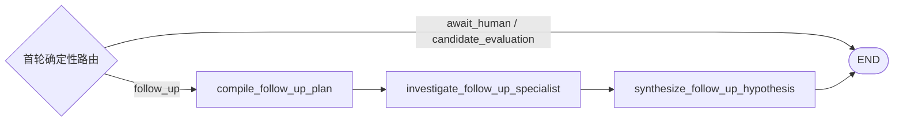

# v3 第二轮综合与新开放假设持久化

## 目标与业务边界

第 92 步已经按持久计划完成第二轮专业任务，并保存各任务的证据、专业结果和工作摘要。本片只综合这些第二轮业务事实，生成一份绑定第二轮协调计划的新开放假设，使后续独立审查能够明确区分首轮判断与补查后的判断。

第二轮综合不读取 checkpoint 中自报的材料，也不重新调用专业任务。输入范围必须由第二轮协调计划和已提交任务事实重建。模型仍只提出自由文本假设、置信度、支持证据、反证与未解问题；系统注入不可变 `pending_review` 状态。新假设不表示根因已被证明，也不提供处置或执行资格。

本片不再次独立审查或确定性路由，不创建第三轮，不进入 `await_human` 或候选评估，不实现人工暂停、规划、处置、父运行结算、MCP 或通用 Worker 对 v3 的领取。

## 按轮综合调用身份

首轮和第二轮综合都使用现有根级 `CallOperation.SYNTHESIZE`，不增加语义重复的新操作。调用账本已有 `invocation_index`，本片把它确定为根级综合的轮次槽位：

| 目标轮次 | `invocation_index` | 提示与角色版本 |
| --- | --- | --- |
| 第 1 轮 | `0` | `open-hypothesis-synthesis-v1` / `dynamic-synthesis-v1` |
| 第 2 轮 | `1` | `follow-up-open-hypothesis-synthesis-v1` / `dynamic-follow-up-synthesis-v1` |

槽位继续进入调用幂等键，同一父调查尝试可以分别预留两次根级综合而不冲突。模型成功后跨父尝试恢复时，服务只查找目标槽位的成功调用，并精确比较该轮规范模型输入和上下文清单；首轮成功调用不能冒充第二轮来源。同一运行、同一槽位出现多个成功综合调用或已有成功调用使用其他材料时拒绝继续。

现有调用结果 `open-hypothesis-synthesis-result-v1` 和开放假设输出契约不变，因为第二轮改变的是材料范围与提示，而不是结构化输出语义。共享模型次数、总时限、Token 和估算费用预算继续累计，新轮次与新父租约都不能清零。

## 第二轮上下文与提示

现有 v1 系统提示明确限定“首轮材料”，不能在相同版本下静默改变含义。第二轮使用新的专用 v1 提示 `follow-up-open-hypothesis-synthesis-v1`，明确只比较当前第二轮 `working_summaries` 与完整 `evidence`，保留分歧和未确定判断，不读取或接受第一轮专业摘要、开放假设、独立审查或路由作为模型材料。

事故输入仍作为根级背景。上下文加载器依据综合槽位选择对应业务轮次，并从该轮协调计划重建完整任务集合；每项任务都必须已经成功且存在匹配的证据、结果和工作摘要。材料清单继续记录事故、任务分派、证据与工作摘要的身份、版本和散列，第二轮任务 ID 集合必须与计划完全相等。

上下文服务的调用者必须显式提供综合槽位，预算预留事务也按账本保存的槽位重新加载同一轮材料。当前切片只接受槽位 0 和 1，不因底层字段允许更大整数而提前开放任意轮次。

## 开放假设来源与状态

复用现有 `investigation_open_hypotheses`。该表已经以 `(round_id, investigation_run_id)` 唯一，并通过复合外键绑定同运行协调计划、父调查尝试和成功综合调用，因此无需新增表或列即可在同一运行保存首轮和第二轮两条记录。

第二轮记录的来源链为：

```text
第二轮开放假设
  -> 第二轮协调计划
  -> 首轮 follow_up 路由
  -> 首轮独立审查与开放假设
```

记录继续使用稳定的按轮 UUID、`open-hypothesis-v1` 内容版本和 `pending_review` 状态。首轮假设及其审查、路由事实不可修改、替代或删除；来源关系通过第二轮计划已有的 `source_review_route_id` 追溯，不复制第一轮内容到新记录。

读取时从目标 `round_id` 重建协调计划及其全部任务材料，复核综合槽位必须等于 `round_number - 1`，并比较调用输入、上下文清单、输出、证据闭包、内容散列和时间顺序。第二轮假设只能引用第二轮材料中存在的证据 ID。只读列表应按业务轮次稳定排序，而不是仅依赖可能相同的创建时间。

本片不新增公开 HTTP API。开放假设继续作为内部可查询事实；已有查询从返回单轮记录自然扩展为按轮返回多条经过来源复核的记录。

## 服务与图状态

首轮综合的公开行为和 v1 提示保持兼容。实现可保留 `FirstRoundSynthesizer` 作为历史包装，并新增职责明确的第二轮综合服务，或抽取要求显式轮次、计划、结果和提示版本的共用内核；不能通过删除首轮校验让调用方选择任意业务轮次。

第二轮服务接收第 92 步已经验证的补查执行结果，只投影 `follow_up_plan` 和 `follow_up_results` 作为调用材料。图状态新增独立的 `follow_up_hypothesis`，不能覆盖首轮 `open_hypothesis`。新的阶段结果契约要求：

- `follow_up` 路由必须有第二轮计划、完整第二轮专业结果和绑定该计划轮次的新开放假设；
- 新假设的运行、轮次和来源调用必须与第二轮计划一致；
- `await_human` 与 `candidate_evaluation` 不能携带第二轮计划、结果或新假设。

图 v7 已经存在终态 checkpoint，因此固定为历史版本。图 v8 只在第二轮专业分支汇合后增加综合节点：



图 v1～v7 保留各自拓扑、状态与 checkpoint 恢复语义。图 v8 的 metadata 和 state 同时固定 `workflow_version=v3` 与 `graph_version=dynamic-investigation-graph-v8`。综合、审查、路由、补查计划和第二轮执行的能力版本集合需要包含 v8，以复核图前半段业务事实；第二轮综合写入能力只允许 v8。

## 失败与恢复

- 第二轮任务、证据、结果或工作摘要不完整，或者上下文任务集合与第二轮计划不一致时，在模型预留前拒绝。
- 模型输出引用第一轮专有或其他运行的证据时，开放假设保存前拒绝，不能把越界内容结算为业务事实。
- 模型调用成功而开放假设尚未提交时，新父租约按槽位 1 和完整上下文复用成功调用，不再次请求模型。
- 开放假设已提交而节点 checkpoint 尚未写入时，恢复从业务库复核并返回原记录，不新增调用或假设。
- 调用失败或结果未知时沿用现有账本语义与实际可取得用量；不能生成假设，也不能声称物理上恰好调用一次。
- 同轮冲突假设、多个成功调用、调用槽位与轮次不符、来源计划漂移、租约失效或图版本不兼容时拒绝推进。

业务数据库与 checkpoint 仍不组成跨库事务。恢复依赖不可变调用账本、按轮开放假设唯一约束和最终业务来源复核。

## 迁移与兼容

迁移 `0050_second_round_synthesis` 只扩展 `investigation_runs.graph_version` 约束以允许 `dynamic-investigation-graph-v8`。现有开放假设、调用账本和上下文清单列能够表达第二轮来源，不新增业务表、字段、索引或 HTTP 路由。

存在图 v8 运行时拒绝降级到 `0049_second_round_investigation`；允许降级时恢复图 v1～v7 约束。旧开放假设、调用槽位 0、v1 提示、旧图 checkpoint 和 v1/v2 工作流不回填、不改写。

## 验收标准

- 自动化测试证明首轮与第二轮综合槽位、提示和材料范围严格对应；阶段契约、持久来源校验和既有证据闭包测试覆盖错误轮次与越界证据拒绝。
- 真实 PostgreSQL 与独立 checkpoint 测试证明 `follow_up` 路径只向第二轮综合发送第二轮任务 ID、工作摘要与完整证据，并保存绑定第二轮计划的 `pending_review` 假设。
- 同一运行可以保存两条按轮稳定读取的开放假设；首轮记录、审查和路由保持不变，第二轮记录的调用槽位为 1，父运行继续 `running`。
- `await_human` 与 `candidate_evaluation` 不产生槽位 1 综合调用或第二轮开放假设。
- 覆盖模型成功后假设提交前、假设提交后 checkpoint 前两个恢复窗口，证明成功调用和业务事实分别复用，预算累计不清零。
- 图 v1～v7 checkpoint、v3 启动和查询、Worker 版本隔离保持兼容；迁移升级到唯一 head `0050_second_round_synthesis`，存在 v8 运行时安全拒绝降级。
- 自动化测试使用假模型和固定冻结材料，不把结果描述为现场遥测，也不升级用户 Compose 业务数据库。
