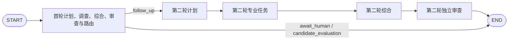

# v3 第二轮开放假设独立审查与恢复

## 目标与业务边界

第 93 步已经只用第二轮补查材料生成新的 `pending_review` 开放假设。本片在该事实后增加一次独立审查，使补查后的判断拥有与首轮相同的结构化质疑、证据闭包和恢复能力，同时保持两轮调用与材料完全隔离。

审查模型只判断支持是否充分，记录接受的支持、反证、证据缺口、竞争性解释、建议方向和有限补查意图。审查意见不是客观证明、最终根因、确定性路由、人工审批或执行资格。模型不得创建任务、指定预算、调用工具或授权处置。

本片不再次执行确定性路由，不创建第三轮，不进入图内人工等待、候选结论或规划，不结算父调查，也不开放通用 Worker 对 v3 的领取。

## 图版本与阶段结果

图 v8 已存在终态 checkpoint，因此固定为历史第二轮综合图。新运行发布图 v9，只在 `follow_up` 路径的第二轮开放假设后增加审查节点：

图 v1～v8 保留各自拓扑、状态与 checkpoint 恢复语义。图 v9 的 metadata 和 state 同时固定 `workflow_version=v3` 与 `graph_version=dynamic-investigation-graph-v9`。阶段结果增加独立 `follow_up_hypothesis_review`：补查路径必须绑定第二轮开放假设，另外两条路径必须为空。最终返回前从业务数据库依次复核两轮计划、任务结果、假设、首轮审查与路由以及第二轮审查，checkpoint 不替代业务事实。

## 按轮审查调用身份

两轮审查继续复用根级 `CallOperation.REVIEW`，以业务轮次固定调用槽位：

| 目标轮次 | `invocation_index` | 提示与角色版本 |
| --- | --- | --- |
| 第 1 轮 | `0` | `open-hypothesis-review-v1` / `independent-review-v1` |
| 第 2 轮 | `1` | `follow-up-open-hypothesis-review-v1` / `independent-follow-up-review-v1` |

槽位进入现有调用幂等键。上下文准备、预算预留、调用结算、成功调用恢复和审查事实来源复核都必须使用同一槽位。每个运行、每个审查槽位必须且只能有一条成功调用；已有成功调用若使用其他材料，或同槽位出现多条成功调用，均拒绝继续。

审查继续共享原运行的模型次数、总时限、Token 和估算费用预算。父租约更换、第二轮开始或恢复都不能清零额度。外部请求前仍由预算事务预留，本片不承诺物理上恰好一次调用。

## 第二轮上下文与提示

首轮提示明确限定首轮材料，不能静默扩展。第二轮使用新提示 `follow-up-open-hypothesis-review-v1`，只审查第二轮开放假设与其来源综合调用使用的第二轮工作摘要和完整证据，不读取首轮假设、首轮审查或路由作为模型材料。

上下文加载器根据审查槽位选择业务轮次，从该轮计划重建完整任务、证据、结果和工作摘要，并加载该轮开放假设及来源综合调用。审查材料清单必须与来源综合清单逐项相同，再追加唯一的当前开放假设材料。开放假设、报告、摘要和证据文本均视为不可信材料，不能改变系统指令或授予权限。

模型输出结构继续使用 `HypothesisReviewProposal` 和 `hypothesis-review-result-v1`，因为字段语义没有变化。证据引用只能来自当前轮输入，接受的支持还必须属于当前开放假设的支持证据集合。

## 持久化与失败恢复

复用 `investigation_hypothesis_reviews`。该表已经按开放假设和运行唯一，并绑定同运行、同轮开放假设、父尝试和成功审查调用，因此可以分别保存两轮审查而无需新增业务表或字段。查询按业务轮次稳定返回，不能用创建时间推断轮次。

- 模型结果已成功写入调用账本、第二轮审查事实尚未提交时，新父租约复用槽位 1 的成功结果，不再次访问模型。
- 第二轮审查事实已提交、节点 checkpoint 尚未写入时，恢复直接复用并复核原事实。
- 租约失效、图版本不符、材料漂移、证据越界、跨轮假设、同槽位多个成功调用或 checkpoint 自报事实与数据库不一致时拒绝推进。

迁移 `0051_second_round_review` 把运行图版本约束扩展到 v9，并把根级 `review` 的合法槽位从仅 0 扩展为 0/1；`coordinate` 仍只能使用槽位 0。存在图 v9 运行或槽位 1 审查调用时拒绝降级到 `0050_second_round_synthesis`。允许降级时恢复图 v1～v8 和 `review=0` 约束。旧审查、调用槽位 0、旧提示、图 v1～v8 checkpoint 和 v1/v2 工作流不回填、不改写。

## 验收标准

- `follow_up` 路径恰好保存两轮开放假设、两轮独立审查和槽位 0/1 的两次成功审查调用；第二轮审查清单只包含第二轮综合材料及第二轮假设。
- `await_human` 与 `candidate_evaluation` 路径不产生第二轮假设或第二轮审查调用，父运行继续为 `running`。
- 模型成功后事实提交前、事实提交后 checkpoint 前两个窗口均可跨父租约恢复，且不重复外部请求或预算消耗。
- 同槽位重复成功调用、跨轮材料或来源篡改会被查询和恢复入口拒绝。
- 图 v1～v8 checkpoint、v3 启动、Worker 版本隔离和迁移链保持兼容，Alembic 唯一 head 为 `0051_second_round_review`。
