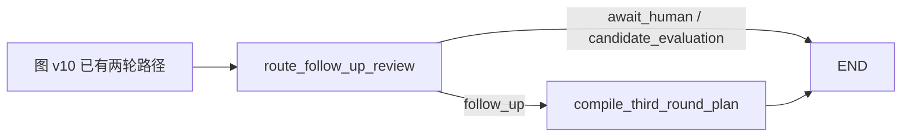

# v3 第二轮补查路由的第三轮计划持久化

## 目标与边界

第 95 步已经把第二轮独立审查保存为确定性路由。本片只在第二轮路由为 `follow_up` 时，把完整补查建议确定性编译为第 3 轮协调计划，并在同一事务中创建第 3 轮和待执行专业任务，使多轮调查第一次到达冻结策略允许的最大轮次。

本片不执行第三轮任务，不调用新模型或工具，不进入第三轮综合、审查与路由，不进入 LangGraph 人工暂停、候选结论、规划或处置，也不结算父调查。第二轮路由为 `await_human` 或 `candidate_evaluation` 时不创建第三轮事实。

## 图版本与结果契约

图 v10 已存在终态 checkpoint，因此固定为历史第二轮路由图。新运行发布图 v11，只在第二轮路由后增加条件分支和第三轮计划节点：

新增阶段结果在既有 `SecondRoundRoutingResult` 上增加可空 `third_round_plan`：

- 第二轮路由为 `follow_up` 时必须存在，并绑定该路由、同一运行、无模型调用来源且目标轮次为 3；
- 第二轮路由为 `await_human` 或 `candidate_evaluation` 时必须为空；
- 首轮不是 `follow_up` 时第二轮路由和第三轮计划都必须为空。

图 v1～v10 保留各自拓扑、状态和恢复语义。图 v11 的 metadata 与 state 同时固定 `workflow_version=v3`、`graph_version=dynamic-investigation-graph-v11`，不能用新图恢复旧 checkpoint。

## 确定性编译与容量

既有补查编译规则从“首轮后第二轮”泛化为“当前路由的下一轮”，继续完整保留审查建议，并由系统注入任务键、角色观测窗口、冻结证据快照和截止时间。它只接受：

- 已持久化且决定为 `follow_up` 的审查路由；
- 来源轮次小于冻结 `max_rounds`；
- 建议数量不超过单轮任务上限和剩余总任务槽位；
- 来源路由、来源轮次计划和冻结协调策略的散列、运行与证据范围一致。

第三轮计划继续使用 `compiled-coordination-plan-v1` 和 `coordination-proposal-v1`，不新增规则版本。第 3 轮的真实累计任务数由数据库中第 1～2 轮任务重建；模型文本、checkpoint 和调用方参数都不能替代该计数。

## 持久化、幂等与恢复

现有 `investigation_rounds`、`investigation_coordination_plans` 和 `agent_tasks` 已支持最多 3 轮：轮次按运行与编号唯一，计划以轮次为主键，每条审查路由在同一运行最多派生一份计划，并通过复合外键绑定来源。无需新增业务表、字段或公开 API。

计划服务抽取按路由工作的内核，保留首轮路由到第二轮计划的公开入口，并新增只选择第二轮路由的第三轮入口。持久化入口必须按来源轮次校验图能力：首轮到第二轮继续兼容图 v6～v11，第二轮到第三轮只允许图 v11，防止直接调用服务改变图 v10 的历史语义。

第三轮计划、轮次和任务在有效父租约、运行行锁覆盖的单个事务中提交。保存前中断时恢复重新执行纯编译；事实已提交但 checkpoint 未写时按第二轮路由复用原计划。重复请求、并发竞争、租约失效、来源漂移、非连续轮次、容量变化、冻结范围不一致或已有第三轮绑定不同来源时拒绝推进。

## 迁移与兼容

迁移 `0053_third_round_planning` 只把 `investigation_runs.graph_version` 约束扩展到图 v11。存在图 v11 运行，或存在第 3 轮及以后协调计划时，拒绝降级到 `0052_second_round_routing`；允许降级时恢复图 v1～v10 约束。旧计划、图 v1～v10 checkpoint 和 v1/v2 工作流不回填、不改写。

## 验收标准

- 第二轮 `follow_up` 保存绑定第二轮路由的第 3 轮计划、运行轮次和待执行任务；建议、角色、目标、冻结快照与观测窗完整保留。
- 第二轮 `await_human` 或 `candidate_evaluation` 不创建第三轮，首轮非补查路径仍保持原事实边界。
- 第三轮计划只允许图 v11 写入；图 v10 直接调用持久化服务被拒绝，旧 checkpoint 继续由旧图恢复。
- 计划提交前和提交后 checkpoint 前两个窗口均可跨父租约恢复，且模型、工具和预算账本不变化。
- 第三轮计划事实和图 v11 运行分别触发降级保护；唯一 Alembic head 为 `0053_third_round_planning`。
