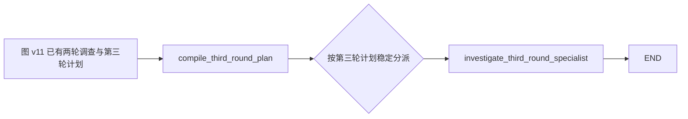

# v3 第三轮专业任务执行与恢复

## 目标与边界

第 96 步已经把第二轮 `follow_up` 路由编译为第 3 轮协调计划、业务轮次和待执行任务。本片只从该计划稳定分派 1～3 个第三轮专业任务，复用既有冻结证据范围、任务尝试、共享调用预算、专业工具循环、结果与工作摘要持久化，使最大轮次的专业调查可执行、可查询并可跨父租约恢复。

本片不执行第三轮综合、独立审查或路由，不进入 LangGraph 人工暂停、候选结论、规划或处置，也不结算父调查。第二轮路由为 `await_human` 或 `candidate_evaluation` 时没有第三轮计划与结果；首轮非补查路径继续直接结束本阶段。

## 图版本与结果契约

图 v11 已存在第三轮计划终态 checkpoint，因此固定为历史第三轮计划图。新运行发布图 v12，在 v11 的计划节点后按已保存分派并行执行第三轮任务：

新增阶段结果在 `ThirdRoundPlanningResult` 上增加独立 `third_round_results`：

- 存在第三轮计划时，结果必须与计划角色一一对应、角色不重复，并使用计划注入的同一冻结证据快照；
- 不存在第三轮计划时，结果必须为空；
- 首轮、第二轮和第三轮同角色结果分别保存在独立状态字段，不能依赖角色键覆盖或跨轮混合；
- 结果只表示第三轮专业任务已持久化成功，不是开放假设、根因证明或执行资格。

图 v1～v11 保留各自拓扑、状态和恢复语义。图 v12 的 metadata 与 state 同时固定 `workflow_version=v3`、`graph_version=dynamic-investigation-graph-v12`，不能用新图恢复旧 checkpoint。

## 执行、预算与持久化

图节点只从已重建通过的第三轮协调计划读取 `round_id` 和分派，并按稳定 `task_key` 生成 LangGraph `Send`。每个专业分支显式传入 `expected_round_number=3`；任务运行层继续核对任务、轮次、角色、冻结快照和父租约，不能通过 checkpoint 或调用方输入执行其他轮次任务。

第三轮复用现有 `agent_task_attempts`、证据、调用账本、结果、工作摘要和任务事件，不新增业务表或字段。每个任务先复用已提交结果，否则创建新的稳定任务尝试；取证和模型调用前继续从原运行预算预留。第三轮不会获得独立额度，前两轮消耗、失败调用和技术重试均继续占用原预算；预算不足时按既有确定性错误停止，不能静默提高上限或清零。

同轮分支可以受限并发，但任务结果、摘要和轮次结算仍由数据库事务决定。部分分支失败时，成功分支的结果保持不可变；新父租约只为未完成任务创建新尝试。任务结果已提交但节点 checkpoint 尚未写入时，恢复直接读取原结果，不再次调用来源或模型。第三轮全部任务成功后只把第 3 轮结算为 `completed`，父运行保持 `running`。

## 迁移与兼容

迁移 `0054_third_round_investigation` 只把 `investigation_runs.graph_version` 约束扩展到图 v12。存在图 v12 运行，或存在第 3 轮及以后任务尝试时，拒绝降级到 `0053_third_round_planning`；任务尝试是 v11“只计划、未执行”边界之后最早且不可变的执行事实，不能仅通过改写运行图版本绕过保护。允许降级时恢复图 v1～v11 约束。

旧计划、任务、结果、图 v1～v11 checkpoint 和 v1/v2 工作流不回填、不改写。现有 API 继续从业务任务表查询第三轮状态、尝试、结果、证据和工作摘要，无需新增公开端点。

## 验收标准

- 第二轮 `follow_up` 的第三轮计划按稳定顺序执行，任务、尝试、证据、结果和工作摘要均绑定第 3 轮；第 3 轮最终为 `completed`，父运行保持 `running`。
- 第二轮 `await_human` 或 `candidate_evaluation` 不创建或执行第三轮，首轮终止路径保持原事实边界。
- 两个以上第三轮分支中一个失败时，已成功分支不会重跑；新父租约只重试失败任务，尝试数、事件游标和共享预算保持一致。
- 结果提交后 checkpoint 前中断能够复用原结果与摘要，不再次调用模型、工具或冻结来源，也不新增预算预留。
- 图 v11 仍只创建待执行第三轮任务；图 v12 checkpoint 与旧图隔离。
- 图 v12 运行和第三轮任务尝试分别触发降级保护；唯一 Alembic head 为 `0054_third_round_investigation`。
